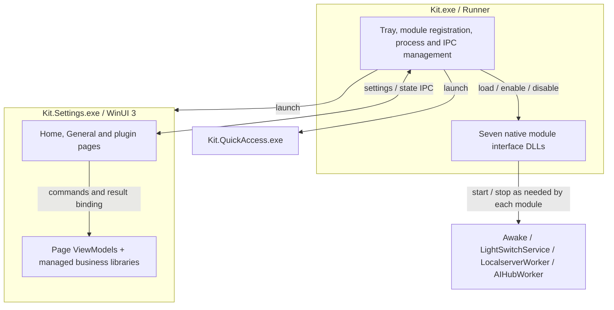
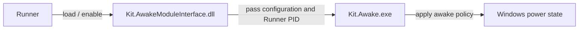
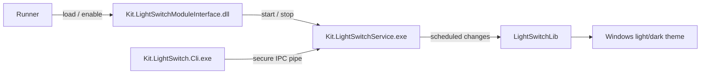
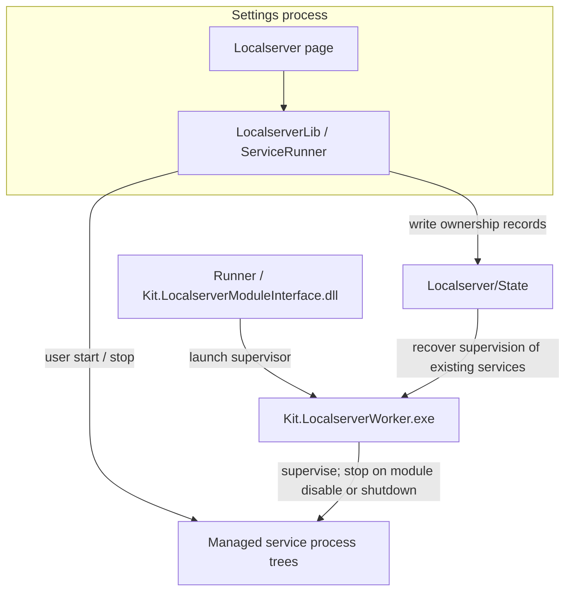
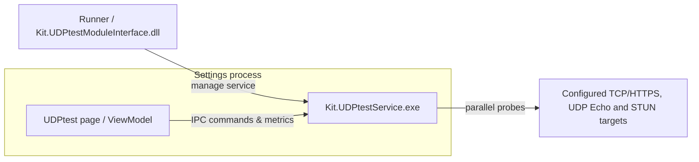
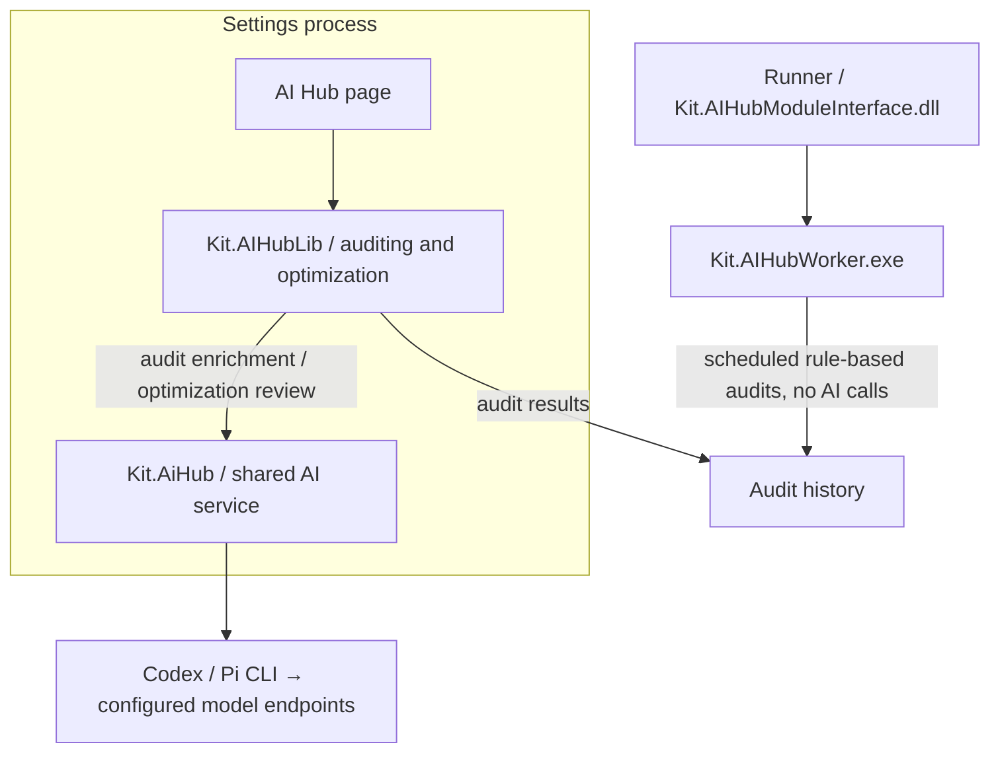
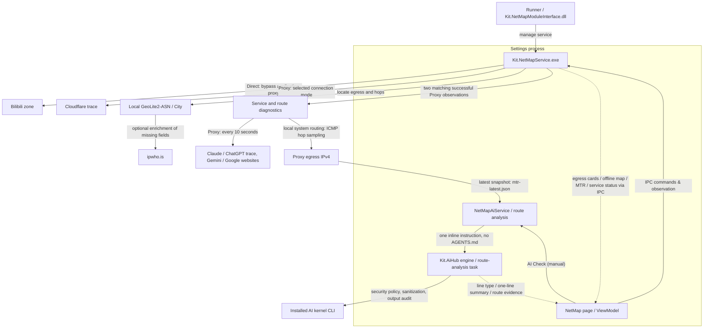

# Kit

**Language / 语言:** English | [中文](README_zh.md)

Kit is a Windows 11 utility collection based on [Microsoft PowerToys](https://github.com/microsoft/PowerToys). Synchronized with PowerToys upstream **v0.102.3001.0**, it reuses the Runner, native module contract and WinUI 3 Settings framework to bring together system utilities, local service management, network diagnostics and AI-assisted maintenance.

Current source version: **3.4.5**, defined in [src/Version.props](src/Version.props). Kit uses separate configuration, window identity and backup paths to distinguish it from official PowerToys installations. Upstream automatic update and telemetry flows are excluded.

[Overview](#1-overview) · [Framework](#2-framework) · [Plugins](#3-plugins) · [Build and Release](#4-build-and-release) · [Data and Logs](#5-data-and-logs) · [Development](#6-development-and-extension)

## 1. Overview

Kit currently includes seven modules. “Plugin” here means a module built and explicitly registered with Kit. Installing third-party plugins by dropping in a DLL or manifest is not supported yet.

| Module | Purpose | Business logic runs in | Origin |
| --- | --- | --- | --- |
| [Awake](#31-awake-keep-the-system-awake) | Keep Windows awake under selected conditions | Separate Awake process | PowerToys |
| [Light Switch](#32-light-switch-theme-scheduling) | Switch light/dark themes on a schedule or manually | Separate Service process | PowerToys |
| [Localserver](#33-localserver-local-service-management) | Configure, start, monitor and stop local services | Settings + supervision Worker | Kit |
| [UDPtest](#34-udptest-configured-line-quality) | Measure configured targets: latency, jitter, success rate and NAT | Settings + diagnosis Service | Kit |
| [AI Hub](#35-ai-hub-auditing-and-system-optimization) | Audit system events, organize downloads and clean caches | Settings + scheduled-audit Worker | Kit |
| [NetMap](#36-netmap-current-egress-and-route-observation) | Observe Direct / Proxy egress, service reachability and ICMP routes | Settings + observation Service | Kit |
| [WinGet](#37-winget-software-updates-and-installation) | Discover, install, update and uninstall software, confirmed batch queues, daily checks and notifications | Separate WingetService process | Kit |

Start `Kit.exe` from the runtime directory, then enable and configure the modules you need in Settings. **Enabling a module and starting its work are separate operations**: Localserver services need individual starts, and NetMap requires Start after enablement.

Home provides real-time system resource telemetry (CPU, memory, storage, dual-GPU / iGPU & dGPU hardware details, driver version, and temperatures) and dual-egress network observation. General contains appearance, startup behavior and shared AI service settings; Quick Access provides module entry points and actions through the tray menu. Kit does not register global keyboard shortcuts. The UI uses native WinUI 3 Fluent Design styling with semantic surface tokens, responsive cards, Cascadia Code monospace typography, accessibility metadata (keyboard-reachable controls, screen-reader names, high-contrast palettes), and English/Chinese presentation (en-US / zh-CN). With the tray icon enabled, closing Settings does not exit Kit. Use the tray menu to exit completely.

## 2. Framework

### 2.1 Processes and calls



| Layer | Responsibility | Source |
| --- | --- | --- |
| Runner | Single-instance entry point, tray, module loading, configuration and process shutdown | [src/runner](src/runner) |
| Settings | Configuration and interaction; hosts some modules' running sessions | [Settings.UI](src/settings-ui/Settings.UI) |
| Quick Access | Shortcut panel, module entry points and available actions | [QuickAccess.UI](src/settings-ui/QuickAccess.UI) |
| Native module interfaces | Common enablement, configuration and action contract, loaded in Runner | [modules](src/modules), [kit_module_interface.h](src/modules/interface/kit_module_interface.h) |
| Business libraries and optional Workers | Execute module work; use a Worker / Service when an independent lifetime is needed | Each module directory |
| Shared infrastructure | Logging, settings, interop and AI execution | [src/common](src/common), [Settings.UI.Library](src/settings-ui/Settings.UI.Library) |

Settings sends configuration and module switches over the existing IPC channel. Runner calls the module interfaces and returns their actual enabled state. **Where work runs determines its lifetime**: separate processes can continue after Settings closes, while tasks hosted in Settings depend on that process. Each plugin handles navigation, minimization and stop events according to its own requirements.

### 2.2 Shared AI services versus AI Hub

| Component | Responsibility |
| --- | --- |
| **AI Services** in General | Configure Codex / Pi kernels, independent Main / Fallback endpoints, models, credentials, context windows and policies; inspect session statistics and safe diagnostics |
| **AI Hub** plugin page | Organize audits, optimization candidates and user actions; business logic lives in `Kit.AIHubLib` |
| **AIHubWorker** | Run scheduled local rule-based audits and save history, without calling AI kernels |

The shared `Kit.AiHub` service powers AI Hub and NetMap AI Check. Model calls always run through native **Codex CLI or Pi CLI**; Kit handles policies, batching, cancellation and validated results. Main and Fallback each have a context-window setting, defaulting to **256,000 tokens**. API mode and reasoning-effort fields accept native identifiers; the installed CLI and endpoint determine support. Saving a value does not guarantee that the model supports it.

Native retries finish before an eligible failure can use a configured Fallback; Kit does not add another same-route retry loop. General shows current-process request/route counts, retry outcomes and reported token usage, with missing usage marked unknown. Safe diagnostics distinguish authentication, timeout, cancellation and output failures. See [native execution and settings](doc/devdoc/ai-service-native.md) for settings ownership, protocol compatibility and diagnostic limits.

### 2.3 Runtime layout

Only the main components are shown. Keep the complete build or staged directory and its dependencies when deploying:

```text
<runtime directory>/
├── Kit.exe
├── Kit.*ModuleInterface.dll
├── Kit.Awake.exe
├── Kit.LightSwitch.Cli.exe
├── Kit.LocalserverWorker.exe
├── Kit.UDPtestService.exe
├── Kit.NetMapService.exe
├── Kit.AIHubWorker.exe
├── Kit.WingetService.exe
├── LightSwitchService/Kit.LightSwitchService.exe
└── WinUI3Apps/
    ├── Kit.Settings.exe
    ├── Kit.QuickAccess.exe
    ├── Kit.AiHub.dll
    ├── Kit.AIHubLib.dll
    ├── LocalserverLib.dll
    ├── UDPtestLib.dll
    └── Kit.NetMapLib.dll
```

## 3. Plugins

### 3.1 Awake: keep the system awake

Keep Windows awake indefinitely, for a set period or under battery-related conditions.



- **Runtime**: a separate Awake process applies the policy; disabling the module or exiting Runner ends it.
- **Configuration and details**: `Awake/`; [module documentation](src/modules/awake/README.md).

### 3.2 Light Switch: theme scheduling and CLI

Switch Windows light/dark themes by schedule, sunset/sunrise, or night light, with complete command-line control (`Kit.LightSwitch.Cli.exe status/light/dark/toggle/schedule`). All seven modules adhere to Kit's zero-hotkey policy.



- **Runtime**: the Service runs the schedule independently of the Settings window. Disabling the module stops the Service.
- **CLI tool**: `Kit.LightSwitch.Cli.exe` allows scripted querying and switching with structured JSON output over local IPC (`Kit_LightSwitch_Cli_{sessionId}`):
  ```powershell
  # Query current theme and scheduling state (human-readable or JSON)
  Kit.LightSwitch.Cli.exe status
  Kit.LightSwitch.Cli.exe status --json

  # Apply theme or toggle immediately
  Kit.LightSwitch.Cli.exe light
  Kit.LightSwitch.Cli.exe dark
  Kit.LightSwitch.Cli.exe toggle

  # Manage scheduling
  Kit.LightSwitch.Cli.exe schedule enable --mode fixed-hours
  Kit.LightSwitch.Cli.exe schedule enable --mode sunset-to-sunrise
  Kit.LightSwitch.Cli.exe schedule enable --mode follow-night-light
  Kit.LightSwitch.Cli.exe schedule disable
  ```
- **Configuration and source**: `LightSwitch/`; [module directory](src/modules/LightSwitch).

### 3.3 Localserver: local service management

Manage local programs and services: launch commands, environment, ports, health and process trees.



- **Startup and supervision**: enabling the module does not start the service catalog automatically. Users start services from the page; the Worker adopts them through ownership records without starting duplicates. Full process tree tracking identifies child payload executables (`launcherPid ➔ childPid`) with per-process resource telemetry and a 60-second historical CPU wave sparkline.
- **Lifetime**: navigation pauses UI sampling. Established services can survive Settings closing. Disabling the module or exiting Runner makes the Worker stop its managed services.
- **Scope**: only process trees with verified ownership are managed. Catalog, state and logs live under `Localserver/`. See the [module documentation](src/modules/Localserver/README.md).

### 3.4 UDPtest: configured line quality

Run TCP/HTTPS, UDP Echo, STUN and NAT probes against configured targets, with latency, jitter, success rates and live charts.



- **Runtime**: users control Start / Stop. Probes run in a dedicated headless background service (`Kit.UDPtestService.exe`) over local IPC, allowing diagnostics to persist cleanly across Settings window closures.
- **Interpretation**: HTTPS timing measures response-header arrival. NAT behavior, UDP echo and TCP/HTTPS use distinct probes and represent different network measurements.
- **Data**: target configuration is saved under `UDPtest/`; sample history stays in memory. See the [module documentation](src/modules/UDPtest/README.md).

### 3.5 AI Hub: auditing and system optimization

Provides Security Audit, Optimization and task policies, using the shared AI service configured in General.



- **Security Audit**: collect Windows events and run local rules, with AI enrichment when available. Existing results can also receive deep analysis. AI failures preserve rule-based findings; long errors wrap inside a bounded, selectable detail area. Authentication failures identify the failed route when known and suggest checking its endpoint, credentials and permissions.
- **Storage composition**: Analyze storage works without AI and observes known browser, shader, package-manager and application caches, crash reports and system-managed storage. It shows measured sizes, file ages, largest files and incomplete coverage. These observations do not become cleanup candidates or promise recoverable space. Core Windows stores, installed programs, runtimes, credentials and sessions stay protected.
- **Optimization**: local scan of downloads and allowlisted caches → AI review of candidate metadata → user review and confirmation → local execution. Unapproved items cannot enter the executable set. Items are revalidated before execution; cache cleanup permanently deletes only files from the reviewed snapshot and skips new, changed, locked or inaccessible files.
- **Task lifetime**: audit and optimization can run concurrently and be cancelled separately. Switching tabs preserves work; disabling the module cancels both tasks. Cancellation does not undo completed file operations.
- **Background audits**: the Worker performs scheduled rule-based scans using the same plugin settings the page edits for cadence and audit mode, so saved schedule changes apply without a restart. The Worker stays resident with the module and only runs while a cadence is configured.
- **Details**: the [module documentation](src/modules/AIHub/README.md) covers architecture and maintenance; [optimization workflow](doc/devdoc/aihub-optimization-3.4.md) describes inventory and cleanup boundaries. Historical validation is recorded in the [changelog](changelog.md).

### 3.6 NetMap: current egress and route observation

Observe the current egress as an external proxy client changes nodes, without importing subscriptions. UDPtest measures configured lines; NetMap shows where traffic currently exits.



- **Start and stop**: enable the module, apply connection settings, then click Start. Detection runs inside the dedicated headless background service (`Kit.NetMapService.exe`), so observation continues when Settings is closed or minimized. Disabling the module or stopping Runner stops the background service.
- **Connection modes**: Proxy supports the system proxy, explicit HTTP/HTTPS/SOCKS5, or system routing/TUN. Direct bypasses application proxies only and cannot bypass a system TUN.
- **Map and data**: bundled Natural Earth offline map, with local ASN/City databases taking priority. Optional online enrichment queries public IPs and can be disabled. ASN databases support manual download with hash verification.
- **Diagnostic limits**: service checks establish checkpoint or website reachability, not account or model availability. ICMP follows local system routing and does not reveal the inside of a proxy tunnel.
- **AI route check**: a manual **AI Check** on the page classifies the latest MTR snapshot into a cross-border line type (such as CMI, CN2 or 163, covering China Mobile, Unicom and Telecom lines) and shows the result on the Proxy card with a one-line summary and route evidence in its details. The check runs through the shared Kit.AiHub engine as the lightweight `route-analysis` task with a single inline instruction, so no `Chains/route-analysis/AGENTS.md` is deployed; host and plugin security policies, sanitization, output auditing and failover all apply. An installed and verified AI kernel in AI Hub is required; missing MTR data, a disabled hub or a missing kernel report specific messages. The result follows the same in-memory lifetime as detection.
- **Runtime**: the native `Kit.NetMapModuleInterface.dll` manages enablement and the `Kit.NetMapService.exe` headless service; results stream to Settings over local IPC. See the [module documentation](src/modules/NetMap/README.md) for setup, sources and validation scope.

### 3.7 WinGet: software updates and installation

Use the installed Windows Package Manager to check updates, search the official WinGet community catalog and manage installed software. Enabling the module starts `Kit.WingetService.exe`, which detects local WinGet availability and owns operations independently of the Settings window.

- **Updates → Installed → Discover**: each workspace remembers its filters, sources, sorting and detailed/compact/grid view. Updates compares installed and available versions, supports ignored packages and hides unknown installed versions unless opted in. Installed includes matched WinGet packages and unmatched Local PC/MSIX records; Discover searches the community catalog rather than the Microsoft Store catalog.
- **Search and details**: names and IDs appear before version and installer metadata are resolved. Unresolved values are explicit; opening details or preparing a batch resolves and validates the selected package. Details show versions, publisher, homepage, license and release notes when provided. Failed or cancelled searches retain the previous results; loading and retry feedback remain visible.
- **Confirmed operations**: select up to 50 packages for a serial install/update/uninstall queue, inspect exact versions, installer options and agreements, then confirm. Native WinGet downloads, verifies and runs the selected package, showing installer/UAC prompts as needed. Operation history and results remain available; cancellation removes pending items, while an active installer is controlled through its native window. Restart recovery checks installation state without automatically replaying operations. Lists can be exported to CSV and selected catalog packages to a WinGet JSON bundle.
- **Checks and storage**: manual or daily checks can report new update sets through Windows notifications; they never install updates automatically. Settings and bounded queue/history state live under `%LOCALAPPDATA%\Kit\Winget`. Native installation owns its temporary downloads and hash checks; the legacy download-export cache uses `%TEMP%\Kit\Winget` with age/size limits. Failed checks back off, and interrupted installations must be checked before another attempt.
- **WinUI 3 + Mica**: the centered page uses semantic colors and icons for readiness and operation outcomes, version emphasis, layered detail cards and a bounded output area. Filters and command bars adapt to narrow windows; daily-check and notification preferences stay vertically stacked. Status polling updates changed values while retaining rows, focus and selection, and native output is filtered and throttled to avoid repeated redraws.

See the [WinGet module documentation](src/modules/Winget/README.md) for source coverage, installer options, cache limits, recovery behavior and matching plugin/service artwork.

## 4. Build and Release

### 4.1 Development environment

Use **Windows 11, PowerShell 7, Visual Studio 2026 and the .NET 10 SDK**. The primary build target is **x64**. Install the C++ desktop, .NET desktop and Windows App SDK components listed in [.vsconfig](.vsconfig). Projects target Windows SDK `10.0.26100.0`.

### 4.2 Build and stage

Run from the repository root. The build scripts initialize the VS environment:

```powershell
# Fast build of essential runtime targets (Runner, Settings UI, Quick Access and modules)
.\tools\build\build-essentials.ps1 -Platform x64 -Configuration Debug

# Or full solution build
.\tools\build\build.ps1 -Platform x64 -Configuration Debug -Path . /restore /p:BuildTests=false
if ($LASTEXITCODE -ne 0) { throw 'Debug build failed.' }
```

After a successful build:
- **Debug binaries**: Launch `x64\Debug\Kit.exe` (Runner) directly. WinUI 3 applications reside in `x64\Debug\WinUI3Apps\Kit.Settings.exe` and `Kit.QuickAccess.exe`.
- **Debug staging**: Run `.\tools\build\Stage-Debug.ps1` to stage the verified debug runtime tree into `bin/debug/<version>/`.
- **Release build and staging**:
```powershell
.\tools\build\build.ps1 -Platform x64 -Configuration Release -Path . /restore /p:BuildTests=false
if ($LASTEXITCODE -ne 0) { throw 'Release build failed; do not stage incomplete output.' }
.\tools\build\Stage-Release.ps1
```

[Stage-Release.ps1](tools/build/Stage-Release.ps1) reads the version file and creates `bin/release/<version>/` plus a SHA-256 verification manifest, not a ZIP. It selects runtime files from the existing shared-runtime build layout, excludes tests and build intermediates, and checks versions, dependencies and copied file hashes. PDB files with a matching executable or DLL are retained; package size depends on the current build. [Stage-Debug.ps1](tools/build/Stage-Debug.ps1) stages Debug output under `bin/debug/<version>/`. Distribute the whole directory, rather than only `Kit.exe` or a plugin DLL.

### 4.3 Validation and real-machine testing

The commands above skip tests; a successful build is not functional validation. Unit tests live in `*.UnitTests` projects in the source tree and run through VS Test Explorer or `vstest.console.exe`. Automated WinUI smoke tests and native module checks live in [tools/tests](tools/tests):

```powershell
# Settings UI and module smoke tests
pwsh -ExecutionPolicy Bypass -File .\tools\tests\SettingsUI\Invoke-ModulePageSmoke.ps1 -Configuration Debug

# Dashboard lifecycle and hardware telemetry smoke tests
pwsh -ExecutionPolicy Bypass -File .\tools\tests\SettingsUI\Invoke-DashboardPageSmoke.ps1 -Configuration Debug

# NetMap network diagnostics and route smoke tests
pwsh -ExecutionPolicy Bypass -File .\tools\tests\NetMap\Invoke-NetMapPageSmoke.ps1 -Configuration Debug
```

Before testing a new version on a real machine, exit the old Kit completely from the tray, then launch `x64\Debug\Kit.exe`. Runner uses a single-instance mechanism, so a running old process can receive the new launch request. To isolate configuration issues, exit Kit and rename `%LOCALAPPDATA%\Kit` as a backup; use fresh settings for the first comparison.

Historical build and regression results are in [changelog.md](changelog.md) and module validation records. They do not certify every real-machine scenario for the current source.

## 5. Data and Logs

The default data root is `%LOCALAPPDATA%\Kit`:

| Relative path | Contents |
| --- | --- |
| `settings.json` | General settings and module switches |
| `<ModuleName>/settings.json` | Module configuration, such as `AIHub/settings.json` and `NetMap/settings.json` |
| `AiHub/service-settings.json` | Shared AI service configuration |
| `AiHub/secrets.dat`, `AiHub/security.md`, `AiHub/chains/` | Encrypted credentials, global and task policies |
| `AiHub/kernels/`, `AiHub/State/` | CLI kernels, audit history and other state |
| `AiHub/Logs/diagnostics.json` | Bounded AI task/route diagnostic history; follows the shared log level |
| `Localserver/services.json`, `Localserver/State/` | Service catalog and process ownership records |
| `NetMap/Data/` | Manually downloaded managed ASN database |
| `RunnerLogs/`, `Settings/Logs/<version>/`, module log directories | Runner, UI and Worker diagnostics |
| `crash.log` | Exception diagnostics |

Windows ignores directory-name casing, so the AI Hub plugin and shared AI service use different filenames: `settings.json` and `service-settings.json`.

AI diagnostic history is limited to 256 records and 256 KiB. It contains request outcomes and safe metadata, without prompts, model output, API keys or endpoint URLs. Turning logging off stops new disk records while current-process statistics remain available.

If configuration writes are denied, check the Windows integrity labels of the build output first. Logs stay at their configured module path; a failed write no longer redirects them to LocalLow, Temp or the executable directory. Existing LocalLow logs from older versions remain available to diagnostics. Resetting settings does not repair output permissions. See the [AI service notes](doc/ai-service-review.md) for the known case and remediation.

## 6. Development and Extension

Modules retain the PowerToys C++ contract and export `kit_create()`. Core interfaces cover enablement, configuration, actions and destruction. Runner explicitly loads the seven modules listed in [KitKnownModules](src/runner/main.cpp).

Adding a module requires:

1. Add the business projects, native module interface and dependencies to `Kit.slnx`. Add a Worker only when independent execution is needed.
2. Register the Runner module list, Settings models and serialization, page navigation and module catalog.
3. Add Home, Quick Access, icons and English/Chinese resources where applicable.
4. Define start/stop, navigation, window-close and Runner-exit behavior; reuse Kit data paths, logging and IPC.
5. Validate core behavior, configuration round trips, registration and lifetime, then run a full build and real-machine checks.

See [src/README.md](src/README.md) for source organization and [PLUGIN_DEVELOPMENT.md](PLUGIN_DEVELOPMENT.md) for the full requirements and template entry points.

## 7. More Documentation

- [Plugin development requirements](PLUGIN_DEVELOPMENT.md): contracts, registration, data isolation, WinUI, localization and lifetime.
- [AI service notes](doc/ai-service-review.md): configuration ownership, execution, known limitations and historical validation.
- [Native AI execution and settings](doc/devdoc/ai-service-native.md): independent route settings, context windows, retries and diagnostics.
- [AI Hub optimization workflow](doc/devdoc/aihub-optimization-3.4.md): read-only inventory, reviewed actions and protected paths.
- [NetMap documentation](src/modules/NetMap/README.md): data sources, design decisions and test scope.
- [Architecture documentation index](doc/devdoc/README.md): PowerToys architecture, Kit design and development notes; proposed directions are not implemented capabilities.
- [Changelog](changelog.md) · [License](LICENSE).
