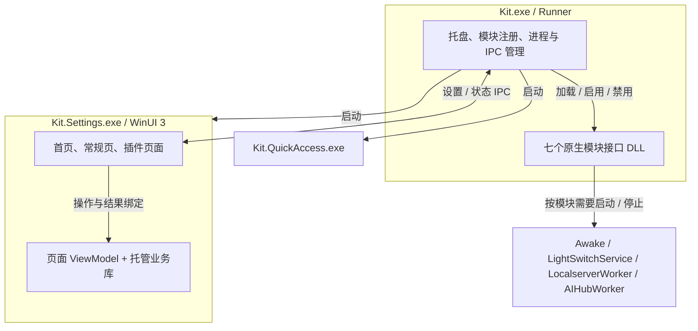
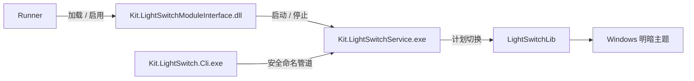
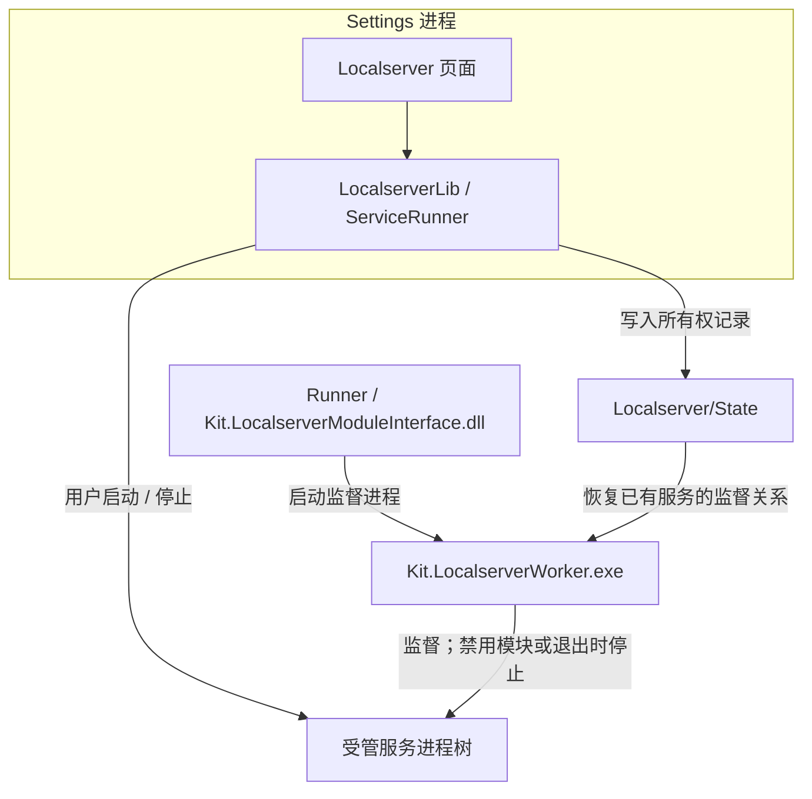
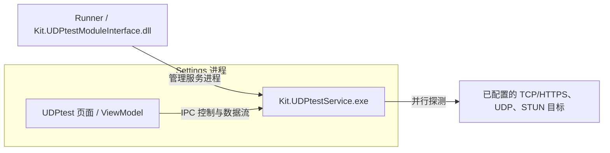
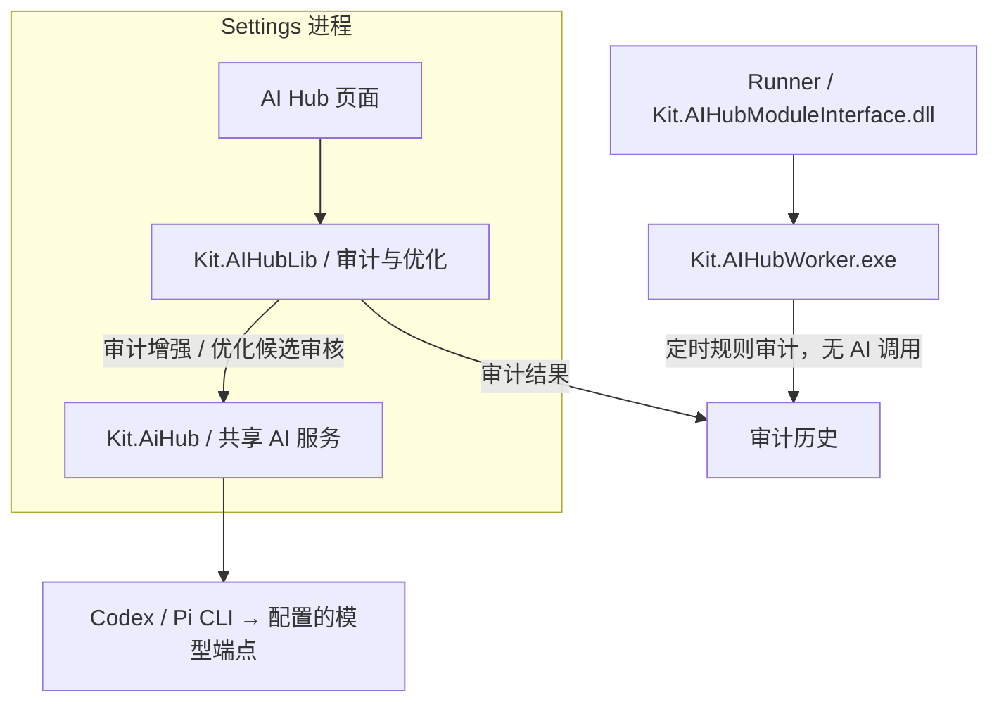
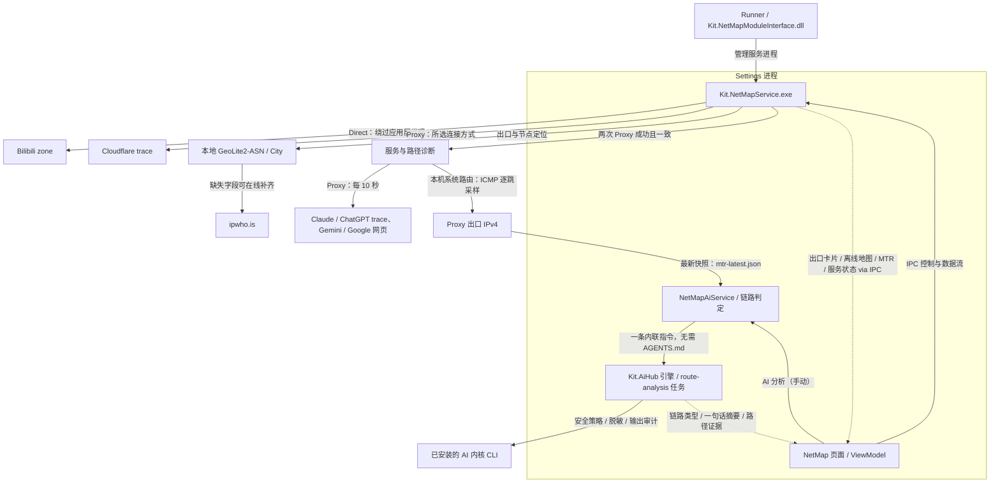

# Kit

**Language / 语言:** [English](README.md) | 中文

Kit 是基于 [Microsoft PowerToys](https://github.com/microsoft/PowerToys) 的 Windows 11 本地工具集（同步对齐上游 PowerToys **v0.102.3001.0** 代码）。它复用 Runner、原生模块接口和 WinUI 3 设置框架，整合系统工具、本地服务管理、网络诊断与 AI 辅助维护。

当前源码版本：**3.4.6**，以 [src/Version.props](src/Version.props) 为准。Kit 使用独立的配置目录、窗口标识和备份路径，可与官方 PowerToys 区分使用；不包含上游的自动更新与遥测流程。

[功能概览](#1-功能概览) · [主框架](#2-主框架) · [插件](#3-插件) · [构建与发布](#4-构建与发布) · [数据与日志](#5-数据与日志) · [开发与扩展](#6-开发与扩展)

## 1. 功能概览

当前有七个内置模块。本文中的“插件”指随 Kit 编译、显式注册的模块，尚不支持通过放入 DLL 或 manifest 动态安装第三方插件。

| 模块 | 主要用途 | 业务运行位置 | 来源 |
| --- | --- | --- | --- |
| [Awake](#31-awake保持唤醒) | 按条件保持系统唤醒 | 独立 Awake 进程 | PowerToys |
| [Light Switch](#32-light-switch主题切换) | 定时或手动切换明暗主题 | 独立 Service 进程 | PowerToys |
| [Localserver](#33-localserver本地服务管理) | 配置、启动、监控和停止本地服务 | Settings + 监督 Worker | Kit |
| [UDPtest](#34-udptest线路质量探测) | 检测已配置线路的延迟、抖动、成功率及 NAT | Settings + 诊断 Service | Kit |
| [AI Hub](#35-ai-hub审计与系统优化) | 系统事件审计、下载整理与缓存清理 | Settings + 定时审计 Worker | Kit |
| [NetMap](#36-netmap网络地图与路径观测) | 观察当前 Direct / Proxy 出口、服务连通性和 ICMP 路径 | Settings + 观测 Service | Kit |
| [WinGet](#37-winget软件更新与安装) | 软件发现、安装、更新与卸载、确认后批量操作、每日检查与通知 | 独立 WingetService 进程 | Kit |

启动运行目录中的 `Kit.exe` 后，在 Settings 中启用需要的模块并配置。**模块开关与任务开始是两层操作**：例如 Localserver 启用后仍需单独启动服务，NetMap 启用后仍需点击 Start。

首页提供实时系统资源监控（CPU、内存、磁盘空间、双显卡/核显与独显硬件信息、驱动版本及温度）与网络双出口（Direct / Proxy）对比；常规页管理外观、启动行为和共享 AI 服务；Quick Access 通过托盘菜单提供模块入口与动作，Kit 不注册全局快捷键。界面采用原生 WinUI 3 Fluent Design 样式，使用层级设计令牌、响应式卡片布局、Cascadia Code 等宽字体、无障碍元数据（键盘可达控件、屏幕阅读器名称、高对比度配色）及中英文呈现（en-US / zh-CN）。启用托盘图标时，关闭 Settings 不代表退出 Kit，完整退出使用托盘菜单。

## 2. 主框架

### 2.1 进程与调用关系



| 层次 | 职责 | 源码入口 |
| --- | --- | --- |
| Runner | 单实例入口、托盘、加载模块、协调配置与进程退出 | [src/runner](src/runner) |
| Settings | 配置和交互界面；承载部分模块的运行会话 | [Settings.UI](src/settings-ui/Settings.UI) |
| Quick Access | 快捷面板、模块入口与可用动作 | [QuickAccess.UI](src/settings-ui/QuickAccess.UI) |
| 原生模块接口 | 实现统一启停、配置和动作契约，加载于 Runner | [modules](src/modules)、[kit_module_interface.h](src/modules/interface/kit_module_interface.h) |
| 业务库与可选 Worker | 执行模块业务；需要独立生命周期时使用 Worker / Service | 各模块目录 |
| 公共基础设施 | 日志、设置、互操作、AI 执行能力 | [src/common](src/common)、[Settings.UI.Library](src/settings-ui/Settings.UI.Library) |

Settings 通过现有 IPC 提交设置和模块开关；Runner 调用模块接口并回传实际启用状态。**业务运行位置决定生命周期**：有独立进程的模块可以在 Settings 关闭后继续工作；在 Settings 内运行的任务依赖该进程，各插件自行处理切页、最小化和停止事件。

### 2.2 共享 AI 服务与 AI Hub 的区别

| 组件 | 负责什么 |
| --- | --- |
| **AI Services**（常规页） | 配置 Codex / Pi 内核及独立的 Main / Fallback 端点、模型、凭据、上下文窗口和策略；查看会话统计与安全诊断 |
| **AI Hub**（插件页） | 组织系统审计、优化候选项与用户操作；业务位于 `Kit.AIHubLib` |
| **AIHubWorker** | 按计划执行本地规则审计并保存历史，不调用 AI 内核 |

共享 `Kit.AiHub` 服务供 AI Hub 和 NetMap AI Check 使用。模型调用始终通过原生 **Codex CLI 或 Pi CLI**，Kit 负责策略、分批、取消和结果校验。Main 与 Fallback 分别设置上下文窗口，默认均为 **256,000 tokens**。API 模式和推理强度可填写原生标识，是否支持由已安装的 CLI 与端点决定；能保存不代表模型支持该配置。

原生重试结束后，符合条件的失败才会进入已配置的 Fallback；Kit 不另套同路由重试循环。常规页展示当前进程的任务/路由计数、重试结果及已报告的 token 用量，缺失用量标为未知。安全诊断区分鉴权、超时、取消和输出错误。配置归属、协议兼容及诊断边界见[原生执行与设置说明](doc/devdoc/ai-service-native.md)。

### 2.3 运行目录

以下仅列主要组件；部署时保留完整构建或整理目录及其依赖：

```text
<运行目录>/
├── Kit.exe
├── Kit.*ModuleInterface.dll
├── Kit.Awake.exe
├── Kit.LightSwitch.Cli.exe
├── Kit.LocalserverWorker.exe
├── Kit.UDPtestService.exe
├── Kit.NetMapService.exe
├── Kit.AIHubWorker.exe
├── Kit.WingetService.exe
├── LightSwitchService/Kit.LightSwitchService.exe
└── WinUI3Apps/
    ├── Kit.Settings.exe
    ├── Kit.QuickAccess.exe
    ├── Kit.AiHub.dll
    ├── Kit.AIHubLib.dll
    ├── LocalserverLib.dll
    ├── UDPtestLib.dll
    └── Kit.NetMapLib.dll
```

## 3. 插件

### 3.1 Awake：保持唤醒

按不限时、定时或电池相关条件保持系统唤醒。


- **运行方式**：独立 Awake 进程执行唤醒策略；禁用模块或 Runner 退出后结束。
- **配置与说明**：`Awake/`；[模块文档](src/modules/awake/README.md)。

### 3.2 Light Switch：主题计划与 CLI 工具

按固定时间、日出日落或夜间模式计划自动切换 Windows 明暗主题，并提供完整的命令行交互控制（`Kit.LightSwitch.Cli.exe status/light/dark/toggle/schedule`）。七个模块统一采用零快捷键设计。



- **运行方式**：Service 执行计划，关闭 Settings 不影响计划；禁用模块会停止 Service。
- **CLI 命令行**：`Kit.LightSwitch.Cli.exe` 支持状态查询、主题即时反转与计划控制，支持标准 JSON 响应结构（通过安全命名管道 `Kit_LightSwitch_Cli_{sessionId}`）：
  ```powershell
  # 查询当前主题与计划状态（文本或标准 JSON 信封）
  Kit.LightSwitch.Cli.exe status
  Kit.LightSwitch.Cli.exe status --json

  # 即时切换或反转主题
  Kit.LightSwitch.Cli.exe light
  Kit.LightSwitch.Cli.exe dark
  Kit.LightSwitch.Cli.exe toggle

  # 计划任务启停与模式配置
  Kit.LightSwitch.Cli.exe schedule enable --mode fixed-hours
  Kit.LightSwitch.Cli.exe schedule enable --mode sunset-to-sunrise
  Kit.LightSwitch.Cli.exe schedule enable --mode follow-night-light
  Kit.LightSwitch.Cli.exe schedule disable
  ```
- **配置与源码**：`LightSwitch/`；[模块目录](src/modules/LightSwitch)。

### 3.3 Localserver：本地服务管理

管理本地程序及服务的启动命令、环境、端口、健康状态和进程树。



- **启动与监督**：启用模块不会自动启动目录中的服务。用户从页面启动，Worker 根据所有权记录接管监督，不重复启动服务。支持多级进程树与底层核心可执行文件探测（展示为 `launcherPid ➔ childPid`），并配有 60 秒平滑贝塞尔波形 CPU 历史趋势折线图（Sparkline）与内存明细悬浮提示。
- **生命周期**：切页暂停界面采样；已启动服务可以在 Settings 关闭后继续运行。禁用模块或退出 Runner 时，Worker 停止受管服务。
- **范围**：仅管理能验证归属的进程树；目录、状态和日志位于 `Localserver/`。详见[模块文档](src/modules/Localserver/README.md)。

### 3.4 UDPtest：线路质量探测

对配置好的目标运行 TCP/HTTPS、UDP Echo、STUN 和 NAT 探测，汇总延迟、抖动、成功率与实时曲线。



- **运行方式**：用户在界面控制 Start / Stop；探测核心引擎运行于独立的无界面后台服务（`Kit.UDPtestService.exe`），关闭 Settings 窗口后后台探测依然持续平稳运行，重新进入界面无缝重连。
- **结果含义**：HTTPS 耗时衡量响应头到达时间；NAT 行为、UDP 回显与 TCP/HTTPS 使用各自的探针，不能混作同一种网络指标。
- **数据**：线路配置保存在 `UDPtest/`，采样历史仅保留在内存。详见[模块文档](src/modules/UDPtest/README.md)。

### 3.5 AI Hub：审计与系统优化

提供 Security Audit、Optimization 及对应的两项任务策略编辑入口，复用常规页配置的共享 AI 服务。



- **安全审计**：收集 Windows 事件并运行本地规则，AI 可用时增强分析；也可对已有结果执行深度分析。AI 失败时保留规则结果，长错误在有界详情区换行并可选中复制；鉴权失败时标明已知的失败路由，提示检查对应端点、凭据和权限。
- **空间构成**：“分析空间”无需 AI，盘点已知浏览器、着色器、包管理器和应用缓存、崩溃报告及系统管理的存储，展示实测大小、文件年龄、最大文件与覆盖不完整的情况。这些观测不会成为清理候选，也不代表可回收空间；Windows 核心存储、已安装程序、运行时、凭据和会话保持保护。
- **系统优化**：本地扫描下载文件及白名单缓存 → AI 审核候选元数据 → 用户审查并确认 → 本地执行。未通过审核的条目不进入可执行集合；执行前重新校验，缓存清理仅永久删除已审核快照中的文件，新文件、变更、占用或不可访问的文件一律跳过。
- **任务生命周期**：审计与优化可同时运行，各自取消；切换标签页不中断任务，关闭模块会取消两项任务。取消不撤销已经完成的文件操作。
- **后台审计**：Worker 只执行定时规则扫描，节奏与审计模式读取页面写入的同一份插件设置，保存后无需重启即可生效；未配置节奏时不执行，Worker 随模块常驻。
- **详细资料**：[模块文档](src/modules/AIHub/README.md)记录架构与维护细节；[优化工作流](doc/devdoc/aihub-optimization-3.4.md)说明盘点和清理边界。历史验证见[变更记录](changelog.md)。

### 3.6 NetMap：网络地图与路径观测

在外部代理客户端切换节点时持续观察当前出口，无需导入订阅。UDPtest 检测“已配置线路的质量”，NetMap 观察“当前实际从哪里出去”。



- **开始与停止**：启用模块、应用连接设置后点击 Start。观测引擎运行于独立的后台服务（`Kit.NetMapService.exe`），关闭或最小化 Settings 窗口后后台观测依然平稳运行，重新进入界面无缝恢复会话。禁用模块或退出 Runner 时自动终止后台服务。
- **连接方式**：Proxy 支持系统代理、显式 HTTP/HTTPS/SOCKS5 或系统路由/TUN。Direct 只绕过应用层代理，无法绕过系统 TUN。
- **地图与数据**：内置 Natural Earth 离线底图，优先使用本地 ASN/City 数据库；在线补齐会查询公网 IP，可关闭。ASN 数据库支持手动下载及哈希校验。
- **诊断边界**：服务检查反映检查点或网页连通性，不代表账号或模型可用；ICMP 路径经本机系统路由，不是代理隧道内部路径。
- **AI 链路判定**：页面上的手动 **AI 分析** 按最新 MTR 快照判定跨境链路类型（如 CMI、CN2、163，可含移动、联通、电信线路），结论以徽标和一句话摘要显示在代理出口卡片，证据在“详情”中。判定经统一 Kit.AiHub 引擎的轻量 `route-analysis` 任务执行，只需一条内联指令，不部署 `Chains/route-analysis/AGENTS.md`；宿主与插件安全策略、脱敏、输出审计与备用链路全部生效。需先在 AI Hub 安装并验证内核；缺少 MTR 数据、AI 中心未开启或内核缺失都有明确提示。结果与检测一样仅保留在当前进程内存。
- **运行方式**：原生 `Kit.NetMapModuleInterface.dll` 管理开关与后台服务进程，检测结果通过本地命名管道非阻塞流式同步至 Settings 界面。使用方法、数据来源与验证范围见[模块文档](src/modules/NetMap/README.md)。

### 3.7 WinGet：软件更新与安装

使用本机 Windows Package Manager 检查更新、搜索官方 WinGet 社区软件目录及管理已安装软件。启用模块后，`Kit.WingetService.exe` 检测本机 WinGet 状态，并独立于 Settings 窗口执行操作。

- **更新 → 已安装 → 发现软件**：各工作区分别记忆筛选、来源、排序及详细/紧凑/网格视图。更新页比较已安装与可用版本，支持忽略软件；未知已安装版本默认隐藏，需主动选择。已安装页包含匹配的 WinGet 软件及未匹配的 Local PC/MSIX 记录；发现页搜索社区目录，不搜索 Microsoft Store 目录。
- **搜索与详情**：先展示名称和 ID，再按需解析版本和安装元数据；未解析值明确标注，打开详情或准备批量操作时解析并校验选中软件。详情展示可用的版本、发布者、主页、许可证和发行说明。搜索失败或取消时保留先前结果，并展示加载及重试反馈。
- **确认后执行**：最多选择 50 个软件组成串行安装/更新/卸载队列，核对精确版本、安装选项和协议后确认。原生 WinGet 负责下载、校验及安装，按需显示安装器和 UAC。操作历史与结果保留；取消会移除待执行项，正在运行的安装器通过其原生窗口控制。重启恢复仅检查安装状态，不自动重放操作。支持列表 CSV 导出及所选目录软件的 WinGet JSON 清单导出。
- **检查与存储**：手动或每日检查可通过 Windows 通知报告新更新集合，不会自动安装。设置与有界队列/历史存放在 `%LOCALAPPDATA%\Kit\Winget`。原生安装自行管理临时下载与哈希校验；旧下载导出缓存位于 `%TEMP%\Kit\Winget`，有年龄和容量限制。检查失败后退避，安装中断后先核查状态再允许尝试。
- **WinUI 3 + Mica**：页面居中，使用语义配色和图标区分就绪状态与操作结果，突出版本信息，并提供分层详情卡片和有界输出区。筛选和命令栏适配窄窗口，每日检查与通知选项上下排列。状态轮询只更新变化值，保留列表行、焦点和选择；原生输出经过过滤和节流，减少重复重绘。

来源范围、安装选项、缓存限制、恢复行为及配套插件/服务图标见 [WinGet 模块文档](src/modules/Winget/README.md)。

## 4. 构建与发布

### 4.1 开发环境

使用 **Windows 11、PowerShell 7、Visual Studio 2026、.NET 10 SDK**，主要构建目标为 **x64**。VS 需安装 C++ 桌面、.NET 桌面及 Windows App SDK 相关组件；组件清单见 [.vsconfig](.vsconfig)，项目目标 Windows SDK 为 `10.0.26100.0`。

### 4.2 编译与整理

从仓库根目录执行；构建脚本会初始化 VS 环境：

```powershell
# 快速构建核心运行时（Runner、Settings UI、Quick Access 及各模块）：
.\tools\build\build-essentials.ps1 -Platform x64 -Configuration Debug

# 或完整解决方案构建：
.\tools\build\build.ps1 -Platform x64 -Configuration Debug -Path . /restore /p:BuildTests=false
if ($LASTEXITCODE -ne 0) { throw 'Debug build failed.' }
```

构建成功后的可执行文件位置：
- **Debug 运行文件**：直接运行 `x64\Debug\Kit.exe`（主程序 Runner）。WinUI 3 应用位于 `x64\Debug\WinUI3Apps\Kit.Settings.exe` 和 `Kit.QuickAccess.exe`。
- **Debug 目录整理**：执行 `.\tools\build\Stage-Debug.ps1`，将校验后的完整运行时归档至 `bin/debug/<版本>/`。
- **Release 构建与发布**：
```powershell
.\tools\build\build.ps1 -Platform x64 -Configuration Release -Path . /restore /p:BuildTests=false
if ($LASTEXITCODE -ne 0) { throw 'Release build failed; do not stage incomplete output.' }
.\tools\build\Stage-Release.ps1
```

[Stage-Release.ps1](tools/build/Stage-Release.ps1) 从版本文件取值，生成 `bin/release/<版本>/` 和 SHA-256 校验清单，不生成 ZIP。脚本从已有的共享运行时构建目录筛选运行文件，排除测试和编译中间产物，并校验版本、依赖及复制文件的哈希；有同名可执行文件或 DLL 的 PDB 会保留，包大小取决于当前构建。Debug 可用 [Stage-Debug.ps1](tools/build/Stage-Debug.ps1) 整理到 `bin/debug/<版本>/`。需要交付整个目录，不能只复制 `Kit.exe` 或某个插件 DLL。

### 4.3 验证与实机测试

上面的命令跳过测试；编译成功不等于功能验证通过。单元测试位于源码中的 `*.UnitTests` 工程，使用 VS Test Explorer 或 `vstest.console.exe` 运行；WinUI 自动化冒烟测试与原生模块检查位于 [tools/tests](tools/tests)：

```powershell
# 模块页面自动化冒烟测试
pwsh -ExecutionPolicy Bypass -File .\tools\tests\SettingsUI\Invoke-ModulePageSmoke.ps1 -Configuration Debug

# 仪表盘全生命周期与硬件监控冒烟测试
pwsh -ExecutionPolicy Bypass -File .\tools\tests\SettingsUI\Invoke-DashboardPageSmoke.ps1 -Configuration Debug

# NetMap 网络诊断与路由链路冒烟测试
pwsh -ExecutionPolicy Bypass -File .\tools\tests\NetMap\Invoke-NetMapPageSmoke.ps1 -Configuration Debug
```

实机测试新版本前，务必先从系统托盘彻底退出旧 Kit，再启动 `x64\Debug\Kit.exe`。Runner 使用单实例机制，旧进程仍在时，新启动请求会转交旧实例。排查配置影响时，可退出 Kit 后将 `%LOCALAPPDATA%\Kit` 改名备份；首次对照测试先使用新配置。

历史构建与回归记录见 [changelog.md](changelog.md) 和各模块验证文档，不作为当前源码已通过全部实机测试的承诺。

## 5. 数据与日志

默认数据根目录为 `%LOCALAPPDATA%\Kit`：

| 相对路径 | 内容 |
| --- | --- |
| `settings.json` | 常规设置、模块开关 |
| `<模块名>/settings.json` | 模块配置，如 `AIHub/settings.json`、`NetMap/settings.json` |
| `AiHub/service-settings.json` | 共享 AI 服务配置 |
| `AiHub/secrets.dat`、`AiHub/security.md`、`AiHub/chains/` | 加密凭据、全局与任务策略 |
| `AiHub/kernels/`、`AiHub/State/` | CLI 内核、审计历史等状态 |
| `AiHub/Logs/diagnostics.json` | 有界 AI 任务/路由诊断历史，遵循共享日志级别 |
| `Localserver/services.json`、`Localserver/State/` | 服务目录、进程所有权记录 |
| `NetMap/Data/` | 手动下载的托管 ASN 数据库 |
| `RunnerLogs/`、`Settings/Logs/<version>/`、模块日志目录 | Runner、界面与 Worker 诊断日志 |
| `crash.log` | 异常诊断 |

Windows 不区分目录大小写，因此 AI Hub 插件与共享 AI 服务使用不同文件名：`settings.json` 与 `service-settings.json`。

AI 诊断历史最多 256 条、256 KiB，仅记录任务结果及安全元数据，不含提示词、模型输出、API key 或端点 URL。关闭日志会停止新增磁盘记录，当前进程的会话统计仍可查看。

若出现配置保存被拒绝，先检查构建产物的 Windows 完整性标签。日志固定写入各模块配置的路径，写入失败不再转存到 LocalLow、临时目录或程序目录；诊断工具仍可读取旧版本留下的 LocalLow 日志。清空配置不能修复产物权限。已知情况与处理说明见 [AI 服务说明](doc/ai-service-review.md)。

## 6. 开发与扩展

模块沿用 PowerToys 的 C++ 契约，导出 `kit_create()`。核心接口包括启用/禁用、读取/保存配置、快捷动作和销毁；Runner 从 [KitKnownModules](src/runner/main.cpp) 显式加载七个模块。

新增模块需完成：

1. 将业务工程、原生模块接口和依赖加入 `Kit.slnx`；仅在需要独立运行时增加 Worker。
2. 注册 Runner 模块列表、Settings 配置模型与序列化、页面导航和模块目录。
3. 按需接入 Home、Quick Access、图标和中英文资源。
4. 明确启停、切页、窗口关闭及 Runner 退出的行为；复用 Kit 的数据路径、日志和 IPC。
5. 验证核心逻辑、配置往返、注册与生命周期，再进行完整构建和实机检查。

工程组织见 [src/README.md](src/README.md)，完整要求和模板入口见 [PLUGIN_DEVELOPMENT.md](PLUGIN_DEVELOPMENT.md)。

## 7. 更多文档

- [插件开发规范](PLUGIN_DEVELOPMENT.md)：接口、注册、数据隔离、WinUI、本地化与生命周期。
- [AI 服务说明](doc/ai-service-review.md)：配置归属、执行机制、已知限制与历史验证。
- [AI 原生执行与设置](doc/devdoc/ai-service-native.md)：独立路由设置、上下文窗口、重试与诊断。
- [AI Hub 优化工作流](doc/devdoc/aihub-optimization-3.4.md)：只读盘点、审核后执行与受保护路径。
- [NetMap 模块说明](src/modules/NetMap/README.md)：数据来源、设计决策与测试范围。
- [架构资料索引](doc/devdoc/README.md)：PowerToys 架构、Kit 设计和开发经验；设计方向不代表已实现能力。
- [变更记录](changelog.md) · [许可证](LICENSE)。
