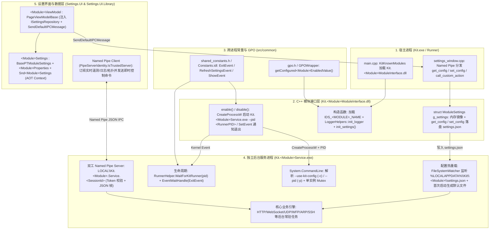
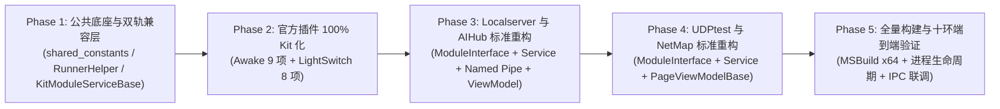

# Kit 插件体系重构与标准化执行计划 (`modules.md`)

> **版本基线**: `v3.1.0` (`main` @ `9457440`)  
> **参考源码与文档基线**: `Source/PowerToys-main`（含主框架 `src/runner`、`src/common`、`src/settings-ui`、官方插件 `src/modules/*`、工程模板 `tools/project_template/ModuleTemplate` 以及官方开发文档 `doc/devdocs/`）  
> **核心目标**:
> 1. **主框架层保留对未来官方插件的向下兼容能力**（双轨兼容协议与工厂入口），确保后续从 `Source/PowerToys-main/src/modules/*` 引入任何新官方插件时可以零摩擦接入，同时严格沿用官方十环插件开发链路与宿主注册规范；
> 2. **现有 2 个官方插件（`Awake`、`LightSwitch`）100% 由 `PowerToys` 转为 `Kit`**，彻底清除残留的 `PowerToys` 命名、注册表路径、Named Pipe、Mutex、Win32 ClassName、CLI 参数与文档链接；
> 3. **现有 4 个非官方自研插件（`Localserver`、`AIHub`、`UDPtest`、`NetMap`）严格按照官方插件开发规范重构**：全部补齐独立后台常驻 Service 进程（脱离 `Settings.UI` 进程生命周期与 `Kit.exe` 直接托管业务逻辑的模式），修复 `ModuleInterface` (`dllmain.cpp`)、`ViewModels`、`Settings.UI.Library` 契约偏差，走通标准十环链路。

---

## 一、 原项目（`Source/PowerToys-main`）架构与插件开发文档深度对标

通过完整审阅 `Source/PowerToys-main/doc/devdocs/` 下的核心架构与插件开发文档，以及 `tools/project_template/ModuleTemplate/` 模板源码，原项目的**主框架架构**与**官方插件开发标准规范**归纳如下：

### 1.1 官方开发文档体系映射表

| 官方文档路径 (`Source/PowerToys-main/doc/devdocs/`) | 核心规范内容 | 当前 `Kit` 对应实现与偏差审计 |
| :--- | :--- | :--- |
| [`doc/devdocs/core/architecture.md`](file:///C:/Users/Zen/Repos/Codings/Kit/Source/PowerToys-main/doc/devdocs/core/architecture.md) | 定义三大核心组件：**Runner (`PowerToys.exe` / `Kit.exe`)**、**Module Interface DLL (`PowerToys.<Module>ModuleInterface.dll` / `Kit.<Module>ModuleInterface.dll`)**、**Settings UI (`WinUI 3`)**，以及复杂模块拆分出的**独立后台进程 (`Service` / `Worker`)**。 | `Awake` 与 `LightSwitch` 遵循该四层结构；但 `AIHub`、`UDPtest`、`NetMap` 缺失独立后台 Service 进程，将后台业务逻辑直接塞进了 `Settings.UI` 进程内，`Localserver` 虽有 `LocalserverWorker` 但缺少 `ModuleInterface` 启停控制。 |
| [`doc/devdocs/core/runner.md`](file:///C:/Users/Zen/Repos/Codings/Kit/Source/PowerToys-main/doc/devdocs/core/runner.md) | Runner 负责：单实例 Mutex、加载 `known_dlls`、托盘图标、全局低级输入钩子 (`LowLevelKeyboardEvent` / `WinHookEvent`)、Named Pipe (`\\\\.\\pipe\\powertoys_runner_<UUID>`) 双向 IPC 服务、GPO 策略轮询、Crash Dump 收集。 | [`src/runner/main.cpp`](file:///C:/Users/Zen/Repos/Codings/Kit/src/runner/main.cpp) 与 [`src/runner/powertoy_module.cpp`](file:///C:/Users/Zen/Repos/Codings/Kit/src/runner/powertoy_module.cpp) 已完成 `Kit` 化并保留 `powertoy_create` 兼容回退。 |
| [`doc/devdocs/development/new-powertoy.md`](file:///C:/Users/Zen/Repos/Codings/Kit/Source/PowerToys-main/doc/devdocs/development/new-powertoy.md) & [`tools/project_template/ModuleTemplate/dllmain.cpp`](file:///C:/Users/Zen/Repos/Codings/Kit/Source/PowerToys-main/tools/project_template/ModuleTemplate/dllmain.cpp) | 定义新建标准插件的完整脚手架：<br>1. `ModuleInterface` 必须包含 `struct ModuleSettings { ... } g_settings;`、`init_settings()`、构造函数中调用 `LoggerHelpers::init_logger(app_key, L"ModuleInterface", ...)`；<br>2. 独立进程项目通过 `enable()` 创建进程（传入 `--pid` 或 `-p`）、通过 `disable()` 触发内核 Event 或终止进程；<br>3. 主框架注册清单（`main.cpp`、`settings_window.*`、`logger_settings.h`、`gpo.h`、`shared_constants.h`、`ModuleType.cs` 等）。 | **重大偏差**：**全部 4 个非官方插件**（`Localserver`、`AIHub`、`UDPtest`、`NetMap`）的 `dllmain.cpp` 构造函数均**漏掉了 `LoggerHelpers::init_logger(...)`**，且均未定义 `g_settings` / `init_settings()`；其中 3 个插件的 `get_name()` 忽略了本地化字符串 `app_name`，直接返回硬编码 `MODULE_NAME`；`NetMap` 的 `set_config()` 甚至未调用 `values.save_to_settings_file()`！ |
| [`doc/devdocs/modules/interface.md`](file:///C:/Users/Zen/Repos/Codings/Kit/Source/PowerToys-main/doc/devdocs/modules/interface.md) | 定义 `PowertoyModuleIface` (`KitModuleIface`) 的完整虚函数表契约：`get_name()`、`get_key()`、`get_config()`、`set_config()`、`call_custom_action()`、`enable()`、`disable()`、`is_enabled()`、`destroy()`、`gpo_policy_enabled_configuration()`、`is_enabled_by_default()`、`signal_event()` 等。 | 接口定义位于 [`src/common/interface/powertoy_module_interface.h`](file:///C:/Users/Zen/Repos/Codings/Kit/src/common/interface/powertoy_module_interface.h)（已支持 `kit_module_create` 与 `powertoy_create` 双符号）。 |
| [`doc/devdocs/core/settings/communication-with-modules.md`](file:///C:/Users/Zen/Repos/Codings/Kit/Source/PowerToys-main/doc/devdocs/core/settings/communication-with-modules.md) & [`runner-ipc.md`](file:///C:/Users/Zen/Repos/Codings/Kit/Source/PowerToys-main/doc/devdocs/core/settings/runner-ipc.md) | 定义 Settings UI ↔ Runner ↔ ModuleInterface ↔ 独立 Service 的两段式通信：<br>1. **Settings UI → Runner**：通过双工 Named Pipe 发送 JSON（含 `{"general": ...}`、模块专属 `{"powertoys": {"<Module>": ...}}`、或 `{"action": {"<Module>": {"action_name": ...}}}`）；<br>2. **ModuleInterface ↔ Service**：通过 `%LOCALAPPDATA%\Kit\<Module>\settings.json` 文件监听（`FileWatcher` / `IFileSystemWatcher`）+ 命名内核 Event（`shared_constants.h`）同步。 | `UDPtest` 与 `NetMap` 的 ViewModel 完全绕过了 `ShellPage.SendDefaultIPCMessage`，修改配置时从未向 Runner 发送 `SndModuleSettings` IPC 消息！ |
| [`doc/devdocs/core/settings/settings-implementation.md`](file:///C:/Users/Zen/Repos/Codings/Kit/Source/PowerToys-main/doc/devdocs/core/settings/settings-implementation.md) & [`viewmodels.md`](file:///C:/Users/Zen/Repos/Codings/Kit/Source/PowerToys-main/doc/devdocs/core/settings/viewmodels.md) | 定义 Settings UI 数据模型与 ViewModel 规范：<br>1. `Settings.UI.Library` 中必须定义 `<Module>Settings : BasePTModuleSettings, ISettingsConfig`、`<Module>Properties`、`Snd<Module>Settings`（并在 `SettingsSerializationContext.cs` 注册 `[JsonSerializable]` 支持 Native AOT）；<br>2. `Settings.UI/ViewModels/<Module>ViewModel.cs` **必须继承 `PageViewModelBase`**，构造函数接收 `(ISettingsRepository<GeneralSettings>, ISettingsRepository<<Module>Settings>, Func<string, int> ipcMSGCallBackFunc)`。 | **重大偏差**：[`UDPtestViewModel.cs`](file:///C:/Users/Zen/Repos/Codings/Kit/src/settings-ui/Settings.UI/ViewModels/UDPtestViewModel.cs) 与 [`NetMapViewModel.cs`](file:///C:/Users/Zen/Repos/Codings/Kit/src/settings-ui/Settings.UI/ViewModels/NetMapViewModel.cs) 直接继承 `Observable` 而非 `PageViewModelBase`，且绕过了 `ISettingsRepository<TModuleSettings>` 单例仓储，导致多页面切换或外部更改配置时缓存不一致！ |
| [`doc/devdocs/core/settings/gpo-integration.md`](file:///C:/Users/Zen/Repos/Codings/Kit/Source/PowerToys-main/doc/devdocs/core/settings/gpo-integration.md) | 定义 GPO 策略完整链路：ADMX/ADML → `src/common/utils/gpo.h` → `src/common/GPOWrapper/GPOWrapper.{idl,h,cpp}` → `ModuleInterface::gpo_policy_enabled_configuration()` → `ModuleGpoHelper.cs`。 | 6 个模块均已接入 `gpo.h` 与 `GPOWrapper`，保持对齐。 |
| [`doc/devdocs/cli-conventions.md`](file:///C:/Users/Zen/Repos/Codings/Kit/Source/PowerToys-main/doc/devdocs/cli-conventions.md) & [`doc/devdocs/modules/lightswitch-cli.md`](file:///C:/Users/Zen/Repos/Codings/Kit/Source/PowerToys-main/doc/devdocs/modules/lightswitch-cli.md) | 定义独立 Service 与 CLI 交互规范：<br>1. C# 进程统一使用 `System.CommandLine` 解析 `--use-kit-config` (`-c`)、`--pid` (`-p`) 等参数；<br>2. **本地 Named Pipe IPC 安全与帧协议**：Pipe 名称绑定当前 SessionId（`LOCAL\Kit.<Module>.Service.<sessionId>`），DACL 限制当前登录用户，服务端校验客户端 Token（`TokenUser`、`TokenSessionId`、`TokenLogonSid` 同源校验 `IsSameLogon`），客户端校验服务端可执行文件签名/路径（`PipeServerIdentity.IsTrustedServer`），采用单行有界 JSON 请求/响应信封（`version: 1`）。 | `LightSwitch` 已实现完整安全 Named Pipe（仅需将 `PowerToys.LightSwitch.Service` 彻底改为 `Kit.LightSwitch.Service`）；4 个非官方模块可复用 [`PipeServerIdentity.cs`](file:///C:/Users/Zen/Repos/Codings/Kit/src/common/ManagedCommon/PipeServerIdentity.cs) 构建统一的托管层 Named Pipe 服务端/客户端通信组件。 |
| [`doc/devdocs/logging.md`](file:///C:/Users/Zen/Repos/Codings/Kit/Source/PowerToys-main/doc/devdocs/logging.md) & [`events.md`](file:///C:/Users/Zen/Repos/Codings/Kit/Source/PowerToys-main/doc/devdocs/events.md) | C++ 使用 `LoggerHelpers::init_logger(moduleName, componentName, LogSettings::...)` 输出至 `%LOCALAPPDATA%\Kit\<Module>\<Component>\Logs\<Version>\`；C# 使用 `ManagedCommon.Logger.InitializeLogger("\\<Module>\\Logs")`；`Trace` 类封装 Telemetry 事件。 | 4 个非官方模块的 C++ `ModuleInterface` 均未调用 `LoggerHelpers::init_logger`，导致日志全部混入 Runner 日志；独立 Service 进程需调用 `Logger.InitializeLogger("\\<Module>\\Service\\Logs")`。 |

---

### 1.2 主框架的双轨兼容机制（保障未来官方插件无缝移植）

为了确保将来从 `Source/PowerToys-main/src/modules/` 引入任何其他官方插件（如 `FancyZones`、`PowerRename`、`AlwaysOnTop`、`ColorPicker`、`FileLocksmith`、`Hosts`、`MeasureTool`、`MouseUtils`、`Peek`、`Workspaces`、`ZoomIt` 等）时无需重写主框架，同时又能让本项目的模块实现 100% `Kit` 化，主框架保持以下**双轨兼容层（Compatibility Shims）**：

1. **C++ ModuleInterface 导出符号与类型双轨支持**
   - [`src/common/interface/powertoy_module_interface.h`](file:///C:/Users/Zen/Repos/Codings/Kit/src/common/interface/powertoy_module_interface.h)：保留 `using KitModuleIface = PowertoyModuleIface;`，同时定义 `kit_module_create` 与 `powertoy_create` 导出函数原型。
   - [`src/runner/powertoy_module.cpp`](file:///C:/Users/Zen/Repos/Codings/Kit/src/runner/powertoy_module.cpp#L15-L21)：Runner 加载模块 DLL 时优先查找 `kit_module_create`，若未找到则自动回退查找 `powertoy_create`。
   - [`src/common/SettingsAPI/settings_objects.h`](file:///C:/Users/Zen/Repos/Codings/Kit/src/common/SettingsAPI/settings_objects.h) & [`settings_helpers.h`](file:///C:/Users/Zen/Repos/Codings/Kit/src/common/SettingsAPI/settings_helpers.h)：提供 `namespace KitSettings = PowerToysSettings;` 别名。
   - [`src/common/utils/gpo.h`](file:///C:/Users/Zen/Repos/Codings/Kit/src/common/utils/gpo.h)：提供 `namespace kit_gpo = powertoys_gpo;` 别名。

2. **Runner 双向 IPC JSON 协议双轨兼容**
   - [`src/runner/settings_window.cpp`](file:///C:/Users/Zen/Repos/Codings/Kit/src/runner/settings_window.cpp#L473-L526)：Runner 的 `dispatch_received_json` 同时解析顶层键 `"kit"` 与 `"powertoys"`（即 `json.HasKey(L"kit") ? json.GetNamedObject(L"kit") : json.GetNamedObject(L"powertoys")`）。
   - [`src/settings-ui/Settings.UI.Library/SndModuleSettings`1.cs`](file:///C:/Users/Zen/Repos/Codings/Kit/src/settings-ui/Settings.UI.Library/SndModuleSettings%601.cs)：保留 `[JsonPropertyName("powertoys")]` 序列化信封，使所有官方模块（及重构后的非官方模块）的 `Snd<Module>Settings` 无需改动即可被 Runner 识别。

3. **主框架新增插件的 10 点标准注册清单（Official Registration Checklist）**
   根据 [`doc/devdocs/development/new-powertoy.md`](file:///C:/Users/Zen/Repos/Codings/Kit/Source/PowerToys-main/doc/devdocs/development/new-powertoy.md#L128-L136) 与 [`src/README.md`](file:///C:/Users/Zen/Repos/Codings/Kit/src/README.md)，任何官方或非官方插件接入主框架必须且只需完成以下 10 处标准注册：
   1. [`src/runner/main.cpp`](file:///C:/Users/Zen/Repos/Codings/Kit/src/runner/main.cpp)：在 `KitKnownModules` 列表中注册 `L"Kit.<Module>ModuleInterface.dll"`；
   2. [`src/runner/settings_window.h`](file:///C:/Users/Zen/Repos/Codings/Kit/src/runner/settings_window.h) & [`src/runner/settings_window.cpp`](file:///C:/Users/Zen/Repos/Codings/Kit/src/runner/settings_window.cpp)：在 `ESettingsWindowNames` 枚举及双向转换函数中注册模块；
   3. [`src/common/logger/logger_settings.h`](file:///C:/Users/Zen/Repos/Codings/Kit/src/common/logger/logger_settings.h)：在 `LogSettings` 中定义 `<module>LoggerName` 与日志保留天数；
   4. [`src/common/utils/gpo.h`](file:///C:/Users/Zen/Repos/Codings/Kit/src/common/utils/gpo.h) & [`src/common/GPOWrapper/GPOWrapper.{idl,h,cpp}`](file:///C:/Users/Zen/Repos/Codings/Kit/src/common/GPOWrapper/GPOWrapper.idl)：定义 `getConfigured<Module>EnabledValue()`；
   5. [`src/common/interop/shared_constants.h`](file:///C:/Users/Zen/Repos/Codings/Kit/src/common/interop/shared_constants.h) & [`src/common/interop/Constants.{idl,h,cpp}`](file:///C:/Users/Zen/Repos/Codings/Kit/src/common/interop/Constants.idl)：定义跨进程内核 Event 名称常量（如 `SHOW_<MODULE>_SHARED_EVENT`、`EXIT_<MODULE>_EVENT`、`REFRESH_<MODULE>_SETTINGS_EVENT`）；
   6. [`src/common/ManagedCommon/ModuleType.cs`](file:///C:/Users/Zen/Repos/Codings/Kit/src/common/ManagedCommon/ModuleType.cs) & [`src/common/Common.UI/SettingsDeepLink.cs`](file:///C:/Users/Zen/Repos/Codings/Kit/src/common/Common.UI/SettingsDeepLink.cs)：添加枚举项与深链映射；
   7. [`src/settings-ui/Settings.UI.Library/Helpers/KitModuleCatalog.cs`](file:///C:/Users/Zen/Repos/Codings/Kit/src/settings-ui/Settings.UI.Library/Helpers/KitModuleCatalog.cs)、[`ModuleHelper.cs`](file:///C:/Users/Zen/Repos/Codings/Kit/src/settings-ui/Settings.UI.Library/Helpers/ModuleHelper.cs)、[`EnabledModules.cs`](file:///C:/Users/Zen/Repos/Codings/Kit/src/settings-ui/Settings.UI.Library/EnabledModules.cs)、[`SettingsSerializationContext.cs`](file:///C:/Users/Zen/Repos/Codings/Kit/src/settings-ui/Settings.UI.Library/SettingsSerializationContext.cs)：注册模块元数据、启用状态与 JSON AOT 序列化上下文；
   8. [`src/settings-ui/Settings.UI/Helpers/ModuleGpoHelper.cs`](file:///C:/Users/Zen/Repos/Codings/Kit/src/settings-ui/Settings.UI/Helpers/ModuleGpoHelper.cs) & [`src/settings-ui/QuickAccess.UI/Helpers/ModuleGpoHelper.cs`](file:///C:/Users/Zen/Repos/Codings/Kit/src/settings-ui/QuickAccess.UI/Helpers/ModuleGpoHelper.cs)：绑定 GPO 查询；
   9. [`src/settings-ui/Settings.UI/SettingsXAML/MainWindow.xaml.cs`](file:///C:/Users/Zen/Repos/Codings/Kit/src/settings-ui/Settings.UI/SettingsXAML/MainWindow.xaml.cs) & [`Views/ShellPage.xaml.cs`](file:///C:/Users/Zen/Repos/Codings/Kit/src/settings-ui/Settings.UI/Views/ShellPage.xaml.cs)：注册导航页映射；
   10. [`Kit.slnx`](file:///C:/Users/Zen/Repos/Codings/Kit/Kit.slnx) & [`src/runner/Kit.vcxproj`](file:///C:/Users/Zen/Repos/Codings/Kit/src/runner/Kit.vcxproj)：将 `ModuleInterface` 与独立 `Service` 纳入解决方案与 `<BuildDependency>`，确保一键编译 `Kit.vcxproj` 时自动产出所有插件二进制。

---

### 1.3 官方插件标准十环开发链路（The 10-Link Official Plugin Pipeline）

对照 [`doc/devdocs/development/new-powertoy.md`](file:///C:/Users/Zen/Repos/Codings/Kit/Source/PowerToys-main/doc/devdocs/development/new-powertoy.md)、[`doc/devdocs/modules/awake.md`](file:///C:/Users/Zen/Repos/Codings/Kit/Source/PowerToys-main/doc/devdocs/modules/awake.md)、[`doc/devdocs/modules/lightswitch.md`](file:///C:/Users/Zen/Repos/Codings/Kit/Source/PowerToys-main/doc/devdocs/modules/lightswitch.md) 与 [`doc/devdocs/modules/lightswitch-cli.md`](file:///C:/Users/Zen/Repos/Codings/Kit/Source/PowerToys-main/doc/devdocs/modules/lightswitch-cli.md)，一个标准插件必须完整实现以下 **10 个环节**：



| 环节编号 | 环节名称 | 官方标准要求（对标 `Source/PowerToys-main`） |
| :---: | :--- | :--- |
| **环 1** | **工程拓扑与构建产物** | 每个模块在 `src/modules/<Module>/` 下包含：<br>① C++ `<Module>ModuleInterface`（输出 `Kit.<Module>ModuleInterface.dll`）；<br>② 独立后台服务项目 `<Module>Service`（输出 `Kit.<Module>Service.exe` 或 `Kit.<Module>.exe`）；<br>③ 纳入 `Kit.slnx` 及 `src/runner/Kit.vcxproj` 的 `<BuildDependency>`。 |
| **环 2** | **C++ `ModuleInterface` 标准实现** | 严格遵循 [`tools/project_template/ModuleTemplate/dllmain.cpp`](file:///C:/Users/Zen/Repos/Codings/Kit/Source/PowerToys-main/tools/project_template/ModuleTemplate/dllmain.cpp)：<br>① 构造函数加载本地化资源 `app_name = GET_RESOURCE_STRING(IDS_<MODULE>_NAME)`，调用 `LoggerHelpers::init_logger(app_key, L"ModuleInterface", LogSettings::<module>LoggerName)`，并调用 `init_settings()`；<br>② 维护 `struct ModuleSettings g_settings;`，`get_name()` 返回 `app_name.c_str()`；<br>③ `set_config()` 解析 `PowerToyValues::from_json_string(config, get_key())`、更新 `g_settings`、调用 `values.save_to_settings_file()`，并触发内核刷新事件或通知 Service；<br>④ 导出 `kit_module_create()`（及兼容 `powertoy_create()`）。 |
| **环 3** | **独立 Service 进程启停控制** | `ModuleInterface::enable()` 使用 `CreateProcessW`（或 `SHELLEXECUTEINFOW`）拉起 `Kit.<Module>Service.exe --use-kit-config --pid <RunnerPID>` 并保存 `m_hProcess`；`disable()` 触发 `Constants::<Module>ExitEvent()`（等待优雅退出，超时则 `TerminateProcess`）并 `CloseHandle(m_hProcess)`；`is_enabled()` 检查 `m_enabled` 与进程存活状态（`WaitForSingleObject(m_hProcess, 0) == WAIT_TIMEOUT`）。 |
| **环 4** | **Service 命令行与单实例防重** | C# Service 使用 `System.CommandLine` 解析 `--use-kit-config` (`-c`) 与 `--pid` (`-p`)（对标 [`doc/devdocs/cli-conventions.md`](file:///C:/Users/Zen/Repos/Codings/Kit/Source/PowerToys-main/doc/devdocs/cli-conventions.md)）；启动时创建命名 Mutex `Global\Kit.<Module>.Mutex`（或 `Local\Kit.<Module>.Mutex`）防止重复拉起；初始化独立日志 `Logger.InitializeLogger("\\<Module>\\Service\\Logs")`。 |
| **环 5** | **Runner 宿主生命周期绑定** | Service 进程通过 [`RunnerHelper.WaitForKitRunner(runnerPid, ...)`](file:///C:/Users/Zen/Repos/Codings/Kit/src/common/ManagedCommon/RunnerHelper.cs) 监听 Runner 进程内核句柄（`SYNCHRONIZE` 阻塞等待，零轮询开销），并同时监听 `EventWaitHandle`（对应 `shared_constants.h` 中的 ExitEvent）。当 Runner 崩溃或模块被禁用时，Service 立即优雅释放端口/句柄并退出。 |
| **环 6** | **配置文件初始化与热重载监听** | Service 启动时检查 `%LOCALAPPDATA%\Kit\<Module>\settings.json` 是否存在，若不存在则通过 `SettingsUtils.SaveSettings` 生成默认配置文件（对标 [`Awake/Program.cs:340-346`](file:///C:/Users/Zen/Repos/Codings/Kit/src/modules/awake/Awake/Program.cs#L340-L346) 与 [`lightswitch-cli.md:7-11`](file:///C:/Users/Zen/Repos/Codings/Kit/Source/PowerToys-main/doc/devdocs/modules/lightswitch-cli.md#L7-L11)）；使用 `IFileSystemWatcherWrapper` 监听 `settings.json` 变更（带防抖与重试读取）+ 监听 `RefreshSettingsEvent`，实现配置毫秒级热更新。 |
| **环 7** | **Settings.UI.Library 标准契约** | 在 `src/settings-ui/Settings.UI.Library/` 中定义：<br>① `<Module>Settings : BasePTModuleSettings, ISettingsConfig`（实现 `GetModuleName()` 与 `UpgradeSettingsConfiguration()`）；<br>② `<Module>Properties`（所有持久化属性带 `[JsonPropertyName]` 并映射至 `SettingsProperty<T>`）；<br>③ `Snd<Module>Settings`（并在 [`SettingsSerializationContext.cs`](file:///C:/Users/Zen/Repos/Codings/Kit/src/settings-ui/Settings.UI.Library/SettingsSerializationContext.cs) 注册 `[JsonSerializable(typeof(SndModuleSettings<Snd<Module>Settings>))]`）。 |
| **环 8** | **Settings.UI ViewModel 标准架构** | 严格遵循 [`doc/devdocs/core/settings/viewmodels.md`](file:///C:/Users/Zen/Repos/Codings/Kit/Source/PowerToys-main/doc/devdocs/core/settings/viewmodels.md)：<br>① `<Module>ViewModel` **必须继承 `PageViewModelBase`**（实现 `ModuleName` 属性与 `InitializeWithHost`）；<br>② 构造函数统一接收 `(ISettingsRepository<GeneralSettings> generalSettingsRepository, ISettingsRepository<<Module>Settings> moduleSettingsRepository, Func<string, int> ipcMSGCallBackFunc)`；<br>③ 启用状态变更发送 `OutGoingGeneralSettings`，模块属性变更发送 `SndModuleSettings<Snd<Module>Settings>` 至 `ipcMSGCallBackFunc`（即 `ShellPage.SendDefaultIPCMessage`）。 |
| **环 9** | **Service ↔ Settings.UI 实时双工 Named Pipe IPC** | 对标 [`doc/devdocs/modules/lightswitch-cli.md`](file:///C:/Users/Zen/Repos/Codings/Kit/Source/PowerToys-main/doc/devdocs/modules/lightswitch-cli.md#L121-L139) 与 [`PipeServerIdentity.cs`](file:///C:/Users/Zen/Repos/Codings/Kit/src/common/ManagedCommon/PipeServerIdentity.cs)：<br>① 管道命名：`LOCAL\Kit.<Module>.Service.<sessionId>`；<br>② 安全校验：Pipe DACL 限制当前用户，客户端连接后调用 `PipeServerIdentity.IsTrustedServer(pipeStream, "Kit.<Module>Service.exe")` 校验服务端进程身份；<br>③ 帧协议：单行 JSON 请求/响应信封（`{"version":1,"command":"...","payload":{...}}` ↔ `{"version":1,"success":true,"state":{...},"events":[...]}`），用于在 UI 打开时实时流式推送日志、吞吐量遥测、网络拓扑及下发即时操作命令，UI 关闭后 Service 在后台零 UI 开销继续运行。 |
| **环 10** | **GPO、Telemetry 与本地化资源** | `gpo.h` / `GPOWrapper` / `ModuleGpoHelper.cs` 策略管控；`trace.h/.cpp` 标准 `Trace:: RegisterProvider()` / `UnregisterProvider()`；`.rc` 与 `Resources.resw` 双语资源完整无硬编码。 |

---

## 二、 现有 2 个官方插件（`Awake`、`LightSwitch`）`PowerToys` → `Kit` 彻底改造清单

通过对比 `Source/PowerToys-main/src/modules/awake`、`Source/PowerToys-main/src/modules/LightSwitch` 与当前 `Kit/src/modules/` 代码，目前 `Awake` 与 `LightSwitch` 虽然完成了基础项目重命名，但源码内部仍残留大量 `PowerToys` 标识符、注册表项、Named Pipe 名称、Win32 窗口类名与 CLI 参数，必须 100% 清理为 `Kit`：

### 2.1 `Awake` 插件全量改造点（共 9 处）

| 序号 | 文件路径 | 行号 | 当前残留的 `PowerToys` 内容 | 目标 `Kit` 改造方案 |
| :---: | :--- | :---: | :--- | :--- |
| 1 | [`src/modules/awake/Awake/Program.cs`](file:///C:/Users/Zen/Repos/Codings/Kit/src/modules/awake/Awake/Program.cs#L43) | L43 | `MutexName = "PowerToys.Awake.Mutex"` | 改为 `"Kit.Awake.Mutex"` |
| 2 | [`src/modules/awake/Awake/Program.cs`](file:///C:/Users/Zen/Repos/Codings/Kit/src/modules/awake/Awake/Program.cs#L49) | L49 | `TrayWindowId = "PowerToys.Awake.TrayWindow"` | 改为 `"Kit.Awake.TrayWindow"` |
| 3 | [`src/modules/awake/Awake/Program.cs`](file:///C:/Users/Zen/Repos/Codings/Kit/src/modules/awake/Awake/Program.cs#L61) | L61 | CLI Option `"--use-pt-config"`（描述含 `"PowerToys configuration file"`） | 主名称改为 `"--use-kit-config"`（描述改为 `"Use the Kit configuration file for managing Awake."`），同时通过 `Option.Aliases.Add("--use-pt-config")` 保留别名兼容 |
| 4 | [`src/modules/awake/Awake/Program.cs`](file:///C:/Users/Zen/Repos/Codings/Kit/src/modules/awake/Awake/Program.cs#L76) | L76 | `--pid` 描述 `"Bind the execution of Awake to the PowerToys Runner PID."` | 描述改为 `"Bind the execution of Awake to the Kit Runner PID."` |
| 5 | [`src/modules/awake/Awake/Program.cs`](file:///C:/Users/Zen/Repos/Codings/Kit/src/modules/awake/Awake/Program.cs#L156-L157) | L156-L157 | 启动日志输出 `"Launched PowerToys Awake process..."` | 改为 `"Launched Kit Awake process..."` |
| 6 | [`src/modules/awake/Awake/Program.cs`](file:///C:/Users/Zen/Repos/Codings/Kit/src/modules/awake/Awake/Program.cs#L317) | L317 | 调用 `RunnerHelper.WaitForPowerToysRunner(runnerPid, ...)` | 改为调用 `RunnerHelper.WaitForKitRunner(runnerPid, ...)`（并在 [`RunnerHelper.cs`](file:///C:/Users/Zen/Repos/Codings/Kit/src/common/ManagedCommon/RunnerHelper.cs) 中将主方法命名为 `WaitForKitRunner`，保留 `WaitForPowerToysRunner` 作为转发兼容方法） |
| 7 | [`src/modules/awake/Awake/Core/Constants.cs`](file:///C:/Users/Zen/Repos/Codings/Kit/src/modules/awake/Awake/Core/Constants.cs#L9-L11) | L9-L11 | `AppName = "Awake"`、`FullAppName = "PowerToys " + AppName`、`TrayWindowId = "PowerToys.Awake"` | `FullAppName = "Kit " + AppName`、`TrayWindowId = "Kit.Awake"` |
| 8 | [`src/modules/awake/Awake/Core/Manager.cs`](file:///C:/Users/Zen/Repos/Codings/Kit/src/modules/awake/Awake/Core/Manager.cs#L39) | L39 | 注册表键 `@"SOFTWARE\Microsoft\PowerToys\Awake"` | 改为 `@"SOFTWARE\Kit\Awake"` |
| 9 | [`src/modules/awake/AwakeModuleInterface/dllmain.cpp`](file:///C:/Users/Zen/Repos/Codings/Kit/src/modules/awake/AwakeModuleInterface/dllmain.cpp#L60) | L60, L174, L204 | 进程拉起参数 `L"--use-pt-config -p "`；命名空间使用 `PowerToysSettings::`、`powertoys_gpo::`；仅导出 `powertoy_create()` | 进程参数改为 `L"--use-kit-config -p "`；命名空间统一为 `KitSettings::`、`kit_gpo::`；导出 `kit_module_create()` 并保留 `powertoy_create()` 转发 |

---

### 2.2 `LightSwitch` 插件全量改造点（共 8 处）

| 序号 | 文件路径 | 行号 | 当前残留的 `PowerToys` 内容 | 目标 `Kit` 改造方案 |
| :---: | :--- | :---: | :--- | :--- |
| 1 | [`src/modules/LightSwitch/LightSwitchCommon/CliProtocol.h`](file:///C:/Users/Zen/Repos/Codings/Kit/src/modules/LightSwitch/LightSwitchCommon/CliProtocol.h#L10-L24) | L10-L24 | `kPipePrefix = L"\\\\.\\pipe\\LOCAL\\PowerToys.LightSwitch.Service."`<br>`kServerExeName = L"PowerToys.LightSwitchService.exe"`（**注意：此处与实际构建产物 `Kit.LightSwitchService.exe` 不一致，会导致 `IsTrustedServerProcess` 身份验证失败！**） | `kPipePrefix` 改为 `L"\\\\.\\pipe\\LOCAL\\Kit.LightSwitch.Service."`<br>`kServerExeName` 改为 `L"Kit.LightSwitchService.exe"` |
| 2 | [`src/modules/LightSwitch/LightSwitchService/LightSwitchService.cpp`](file:///C:/Users/Zen/Repos/Codings/Kit/src/modules/LightSwitch/LightSwitchService/LightSwitchService.cpp#L65-L214) | L65, L149, L213 | 窗口类名 `L"PowerToys.LightSwitch.Window"`；Mutex 名 `L"Local\\PowerToys_LightSwitch_InstanceMutex"` | 窗口类名改为 `L"Kit.LightSwitch.Window"`；Mutex 名改为 `L"Local\\Kit_LightSwitch_InstanceMutex"` |
| 3 | [`src/modules/LightSwitch/LightSwitchService/WinHookEventIDs.cpp`](file:///C:/Users/Zen/Repos/Codings/Kit/src/modules/LightSwitch/LightSwitchService/WinHookEventIDs.cpp#L9) | L9 | `RegisterWindowMessage(L"{12842cb0-6283-4826-9845-353a20d09887}-PowerToys-LightSwitch-ThemeChanged")` | 改为 `L"{12842cb0-6283-4826-9845-353a20d09887}-Kit-LightSwitch-ThemeChanged"` |
| 4 | [`src/modules/LightSwitch/LightSwitchService/ThemeHelper.cpp`](file:///C:/Users/Zen/Repos/Codings/Kit/src/modules/LightSwitch/LightSwitchService/ThemeHelper.cpp#L10) | L10 | `PT_LIGHTSWITCH_ REG_KEY = L"Software\\Classes\\PowerToys\\LightSwitch"` | 改为 `KIT_LIGHTSWITCH_REG_KEY = L"Software\\Classes\\Kit\\LightSwitch"` |
| 5 | [`src/modules/LightSwitch/LightSwitchModuleInterface/dllmain.cpp`](file:///C:/Users/Zen/Repos/Codings/Kit/src/modules/LightSwitch/LightSwitchModuleInterface/dllmain.cpp#L56-L469) | L56, L242, L466 | 使用 `PowerToysSettings::`、`powertoys_gpo::`；仅导出 `powertoy_create()` | 统一使用 `KitSettings::`、`kit_gpo::`；导出 `kit_module_create()` 并保留 `powertoy_create()` 转发 |
| 6 | [`src/modules/LightSwitch/LightSwitchModuleInterface/ExportedFunctions.cpp`](file:///C:/Users/Zen/Repos/Codings/Kit/src/modules/LightSwitch/LightSwitchModuleInterface/ExportedFunctions.cpp#L6-L32) | L6-L32 | 注释与导出函数说明引用 `PowerToys` | 同步更新注释与日志标识为 `Kit` |
| 7 | [`src/settings-ui/Settings.UI/ViewModels/LightSwitchViewModel.cs`](file:///C:/Users/Zen/Repos/Codings/Kit/src/settings-ui/Settings.UI/ViewModels/LightSwitchViewModel.cs#L43-L44) | L43-L44 | `ServicePipePrefix = @"LOCAL\PowerToys.LightSwitch.Service."`<br>`ServiceExeName = "PowerToys.LightSwitchService.exe"`（**同样会导致 UI 连接 Service Pipe 时 `PipeServerIdentity.IsTrustedServer` 校验失败！**） | 改为 `ServicePipePrefix = @"LOCAL\Kit.LightSwitch.Service."` 与 `ServiceExeName = "Kit.LightSwitchService.exe"` |
| 8 | [`src/settings-ui/Settings.UI/SettingsXAML/Views/LightSwitchPage.xaml`](file:///C:/Users/Zen/Repos/Codings/Kit/src/settings-ui/Settings.UI/SettingsXAML/Views/LightSwitchPage.xaml#L256-L257) | L256-L257 | `PageTitle` 硬编码 `"Light Switch"`；文档链接指向 `https://aka.ms/PowerToysOverview_LightSwitch` | 绑定本地化资源或统一品牌链接 |

---

## 三、 现有 4 个非官方自研插件现状深度审计（与官方规范的差距）

对照第一节的**官方十环开发链路**与 `Source/PowerToys-main/doc/devdocs/` 文档，当前 4 个非官方自研插件（`Localserver`、`AIHub`、`UDPtest`、`NetMap`）存在以下共性与个性架构缺陷：

### 3.1 四个非官方插件的共性违规项（Must-Fix Common Issues）

1. **进程模型违规（依赖 `Settings.UI` 或 `Kit.exe` 而非独立常驻 Service）**：
   - `AIHub`、`UDPtest`、`NetMap` **完全没有独立后台 Service 进程**！它们将 SSH 隧道与 AI 进程监控（`AIHub`）、UDP 压测/监听套接字与 WFP 驱动控制（`UDPtest`）、ARP/ICMP 全网段扫描与 SNMP 轮询（`NetMap`）全部直接写在 `Settings.UI/ViewModels/` 中。一旦用户关闭 Settings 设置窗口，或者只启动 `Kit.exe` 托盘而不打开设置界面，这 3 个插件的后台能力完全不存在或随 UI 销毁。
   - `Localserver` 虽然有 `LocalserverWorker` 项目，但 `LocalserverModuleInterface/dllmain.cpp` 的 `enable()` / `disable()` **只是修改了一个 `m_enabled` 布尔值，根本没有启动或停止 `Kit.LocalserverWorker.exe` 进程**！反而是由 `Settings.UI` 的 `LocalserverViewModel` 在打开页面时通过 `Process.Start` 去拉起 Worker。

2. **C++ `ModuleInterface` (`dllmain.cpp`) 全面偏离 [`ModuleTemplate/dllmain.cpp`](file:///C:/Users/Zen/Repos/Codings/Kit/Source/PowerToys-main/tools/project_template/ModuleTemplate/dllmain.cpp)**：
   - **日志未初始化（全部 4 个插件）**：[`LocalserverModuleInterface/dllmain.cpp:66-70`](file:///C:/Users/Zen/Repos/Codings/Kit/src/modules/Localserver/LocalserverModuleInterface/dllmain.cpp#L66-L70)、[`AIHubModuleInterface/dllmain.cpp:69-72`](file:///C:/Users/Zen/Repos/Codings/Kit/src/modules/AIHub/AIHubModuleInterface/dllmain.cpp#L69-L72)、[`UDPtestModuleInterface/dllmain.cpp:54-56`](file:///C:/Users/Zen/Repos/Codings/Kit/src/modules/UDPtest/UDPtestModuleInterface/dllmain.cpp#L54-L56)、[`NetMapModuleInterface/dllmain.cpp:17-20`](file:///C:/Users/Zen/Repos/Codings/Kit/src/modules/NetMap/NetMapModuleInterface/dllmain.cpp#L17-L20) 在构造函数中**全部漏掉了 `LoggerHelpers::init_logger(app_key, L"ModuleInterface", LogSettings::<module>LoggerName)`**（`Localserver` 只调用了 `Logger::info(...)` 而未初始化 Logger），导致模块日志全部污染到 Runner 主日志中。
   - **本地化名称被忽略（3 个插件）**：`Localserver`、`AIHub`、`UDPtest` 在构造函数中调用 `GET_RESOURCE_STRING` 给 `app_name` 赋值后，`get_name()` 却返回了硬编码的 `MODULE_NAME` 常量而非 `app_name.c_str()`。
   - **缺失 `struct ModuleSettings g_settings;` 与 `init_settings()`（全部 4 个插件）**：4 个插件的 `dllmain.cpp` 均未在内存中维护配置结构体 `g_settings`，`get_config()` 也未按官方规范使用 `Settings.add_bool_toggle` / `add_int_spinner` / `add_string` 构造配置描述。

3. **Settings UI `ViewModel` 违反 [`doc/devdocs/core/settings/viewmodels.md`](file:///C:/Users/Zen/Repos/Codings/Kit/Source/PowerToys-main/doc/devdocs/core/settings/viewmodels.md)**：
   - [`UDPtestViewModel.cs:42`](file:///C:/Users/Zen/Repos/Codings/Kit/src/settings-ui/Settings.UI/ViewModels/UDPtestViewModel.cs#L42) 与 [`NetMapViewModel.cs:190`](file:///C:/Users/Zen/Repos/Codings/Kit/src/settings-ui/Settings.UI/ViewModels/NetMapViewModel.cs#L190) 直接继承 `Observable`，**未继承 `PageViewModelBase`**！
   - `UDPtestViewModel` 与 `NetMapViewModel` 构造函数未接收 `ISettingsRepository<UDPtestSettings>` / `ISettingsRepository<NetMapSettings>` 与 `Func<string, int> ipcMSGCallBackFunc`（`ShellPage.SendDefaultIPCMessage`），直接调用 `SettingsUtils.SaveSettings` 落盘，完全跳过了向 `Kit.exe` Runner 发送 `SndModuleSettings` IPC 通知的官方链路。

---

### 3.2 四个非官方插件逐一详细审计表

#### (1) `Localserver` 现状审计
- **目录**: [`src/modules/Localserver/`](file:///C:/Users/Zen/Repos/Codings/Kit/src/modules/Localserver/)（含 `LocalserverModuleInterface`、`LocalserverWorker`）
- **问题清单**:
  1. [`LocalserverModuleInterface/dllmain.cpp`](file:///C:/Users/Zen/Repos/Codings/Kit/src/modules/Localserver/LocalserverModuleInterface/dllmain.cpp)：
     - L69：未调用 `LoggerHelpers::init_logger(MODULE_KEY, L"ModuleInterface", LogSettings::localserverLoggerName)`；
     - L85：`get_name()` 返回 `MODULE_NAME` 而非 `app_name.c_str()`；
     - L108-L120：`enable()` 和 `disable()` 仅打印日志并翻转 `m_enabled = true/false`，**完全没有拉起或终止 `Kit.LocalserverWorker.exe`**！
  2. [`LocalserverWorker/Program.cs`](file:///C:/Users/Zen/Repos/Codings/Kit/src/modules/Localserver/LocalserverWorker/Program.cs)：
     - L12：未引用 `ManagedCommon`，未使用 `System.CommandLine` 解析 `--use-kit-config` / `--pid`，而是手写 `args` 循环解析 `--runner-pid` 与 `--settings-ipc`；
     - L28-L55：未使用 `RunnerHelper.WaitForKitRunner(pid)`（内核对象 `SYNCHRONIZE` 等待），而是用 `while (true) { Task.Delay(5000); Process.GetProcessById(runnerPid); }` 轮询；
     - 未创建单实例 `Mutex`（导致 UI 和 Runner 可能同时拉起多个冲突实例）；
     - 未监听 `Constants.LocalserverExitEvent()` 内核退出事件；
     - 仅在 `--settings-ipc` 模式下才监听 `%LOCALAPPDATA%\Kit\Localserver\ipc-commands.json` 临时文件，缺乏标准双工 Named Pipe IPC Server，无法向 `Settings.UI` 实时流式推送 HTTP 访问日志、WebSocket 连接数和反向代理延迟遥测。
  3. [`src/settings-ui/Settings.UI/ViewModels/LocalserverViewModel.cs`](file:///C:/Users/Zen/Repos/Codings/Kit/src/settings-ui/Settings.UI/ViewModels/LocalserverViewModel.cs)：
     - 仍在 UI 进程内直接管理 `Process` 启停与文件轮询，应改为通过 `SendDefaultIPCMessage` 通知 Runner 同步配置，并通过双工 Named Pipe `LOCAL\Kit.Localserver.Service.<sessionId>` 与后台 Service 实时通信。

#### (2) `AIHub` 现状审计
- **目录**: [`src/modules/AIHub/`](file:///C:/Users/Zen/Repos/Codings/Kit/src/modules/AIHub/)（仅含 `AIHubModuleInterface`，**缺失独立 Service 项目**）
- **问题清单**:
  1. **缺失独立后台服务项目 `AIHubService` (`Kit.AIHubService.exe`)**：所有本地 CLI AI 工具探测（Claude Code、Codex、Gemini CLI、Aider、Cursor、Windsurf、GitHub Copilot CLI、Ollama）、MCP Server 状态管理、Prompt 模板库同步、SSH 远程隧道及 AI 会话守护全部写在 [`src/settings-ui/Settings.UI/ViewModels/AIHubViewModel.cs`](file:///C:/Users/Zen/Repos/Codings/Kit/src/settings-ui/Settings.UI/ViewModels/AIHubViewModel.cs) 中。
  2. [`AIHubModuleInterface/dllmain.cpp`](file:///C:/Users/Zen/Repos/Codings/Kit/src/modules/AIHub/AIHubModuleInterface/dllmain.cpp)：
     - L69-L72：构造函数未调用 `LoggerHelpers::init_logger(MODULE_KEY, L"ModuleInterface", LogSettings::aiHubLoggerName)`；
     - L84：`get_name()` 返回 `MODULE_NAME` 而非 `app_name.c_str()`；
     - L106-L118：`enable()` / `disable()` 为空壳，未拉起或停止 `Kit.AIHubService.exe`。
  3. [`src/common/interop/shared_constants.h`](file:///C:/Users/Zen/Repos/Codings/Kit/src/common/interop/shared_constants.h)：仅定义了 `SHOW_AIHUB_SHARED_EVENT`，缺失 `EXIT_AIHUB_EVENT` 与 `REFRESH_AIHUB_SETTINGS_EVENT`。

#### (3) `UDPtest` 现状审计
- **目录**: [`src/modules/UDPtest/`](file:///C:/Users/Zen/Repos/Codings/Kit/src/modules/UDPtest/)（仅含 `UDPtestModuleInterface` 与 `UDPtestDriver`，**缺失独立 Service 项目**）
- **问题清单**:
  1. **缺失独立后台服务项目 `UDPtestService` (`Kit.UDPtestService.exe`)**：所有高性能 UDP 发包器（Socket 线程池）、UDP 端口监听器、丢包/抖动/延迟模拟引擎、PCAP 抓包导出以及与内核 WFP 驱动 `UDPtestDriver` (`DeviceIoControl`) 的交互全部耦合在 [`src/settings-ui/Settings.UI/ViewModels/UDPtestViewModel.cs`](file:///C:/Users/Zen/Repos/Codings/Kit/src/settings-ui/Settings.UI/ViewModels/UDPtestViewModel.cs) 中。关闭设置界面会导致后台 UDP 监听与弱网模拟立即中断！
  2. [`UDPtestModuleInterface/dllmain.cpp`](file:///C:/Users/Zen/Repos/Codings/Kit/src/modules/UDPtest/UDPtestModuleInterface/dllmain.cpp)：
     - L54-L56：未调用 `LoggerHelpers::init_logger(MODULE_KEY, L"ModuleInterface", LogSettings::udptestLoggerName)`；
     - L68：`get_name()` 返回 `MODULE_NAME` 而非 `app_name.c_str()`；
     - L86-L90：`set_config()` 虽保存了文件并触发了 `REFRESH_UDPTEST_SETTINGS_EVENT`，但未维护 `g_settings`；
     - L104-L116：`enable()` / `disable()` 为空壳，未管理 `Kit.UDPtestService.exe`。
  3. [`src/settings-ui/Settings.UI/ViewModels/UDPtestViewModel.cs`](file:///C:/Users/Zen/Repos/Codings/Kit/src/settings-ui/Settings.UI/ViewModels/UDPtestViewModel.cs)：
     - L42：继承自 `Observable` 而非 `PageViewModelBase`；
     - L104：构造函数仅接收 `SettingsUtils?`，未使用 `ISettingsRepository<GeneralSettings>` 与 `ISettingsRepository<UDPtestSettings>`，也未接收 `Func<string, int> ipcMSGCallBackFunc`；
     - [`src/settings-ui/Settings.UI/SettingsXAML/Views/UDPtestPage.xaml.cs:25`](file:///C:/Users/Zen/Repos/Codings/Kit/src/settings-ui/Settings.UI/SettingsXAML/Views/UDPtestPage.xaml.cs#L25) 实例化 `new UDPtestViewModel()` 时未传入标准依赖。

#### (4) `NetMap` 现状审计
- **目录**: [`src/modules/NetMap/`](file:///C:/Users/Zen/Repos/Codings/Kit/src/modules/NetMap/)（仅含 `NetMapModuleInterface`，**缺失独立 Service 项目**）
- **问题清单**:
  1. **缺失独立后台服务项目 `NetMapService` (`Kit.NetMapService.exe`)**：所有子网 ARP/ICMP 并发扫描、TCP 端口指纹探测、mDNS/SSDP/NetBIOS 设备发现、SNMP 交换机拓扑发现、定时巡检任务与设备离线告警全部塞在 [`src/settings-ui/Settings.UI/ViewModels/NetMapViewModel.cs`](file:///C:/Users/Zen/Repos/Codings/Kit/src/settings-ui/Settings.UI/ViewModels/NetMapViewModel.cs) 中。
  2. [`NetMapModuleInterface/dllmain.cpp`](file:///C:/Users/Zen/Repos/Codings/Kit/src/modules/NetMap/NetMapModuleInterface/dllmain.cpp)：
     - L17-L20：未调用 `LoggerHelpers::init_logger(MODULE_KEY, L"ModuleInterface", LogSettings::netMapLoggerName)`；
     - L29-L36：**严重 Bug**：`set_config()` 中仅调用了 `from_json_string(config, get_key())`，**既没有解析字段，也没有调用 `values.save_to_settings_file()`**！
     - L42-L54：`enable()` / `disable()` 为空壳，未拉起或停止 `Kit.NetMapService.exe`。
  3. [`src/settings-ui/Settings.UI.Library/NetMapProperties.cs`](file:///C:/Users/Zen/Repos/Codings/Kit/src/settings-ui/Settings.UI.Library/NetMapProperties.cs)：
     - 属性直接定义为裸 `int` / `bool` / `string`（如 `public int ScanTimeoutMs { get; set; } = 800;`），未像官方模块（如 `AwakeProperties`、`LightSwitchProperties`、`LocalserverProperties`）那样封装为 `BoolProperty` / `IntProperty` / `StringProperty` 以便与 C++ `PowerToyValues` 的 `{ "value": ... }` JSON 格式对齐！
  4. [`src/settings-ui/Settings.UI/ViewModels/NetMapViewModel.cs`](file:///C:/Users/Zen/Repos/Codings/Kit/src/settings-ui/Settings.UI/ViewModels/NetMapViewModel.cs)：
     - L190：继承自 `Observable` 而非 `PageViewModelBase`；
     - L204：无参构造函数，未使用 `ISettingsRepository<GeneralSettings>`、`ISettingsRepository<NetMapSettings>` 与 `ShellPage.SendDefaultIPCMessage`。

---

## 四、 四个非官方插件标准化重构设计方案

### 4.1 统一后台 Service 架构与目录规划

将 4 个非官方插件统一重构为 **`ModuleInterface (C++ DLL)` + `Service (C# .NET 10 独立进程 EXE)` + `Settings.UI (WinUI 3 纯前端视图与 IPC 客户端)`** 的标准三层解耦架构：

| 模块名称 | ModuleInterface 项目与产物 | 独立后台 Service 项目与产物 | 输出子目录 (`x64/$(Configuration)/`) | Named Pipe 端点名称 (`LOCAL\...`) |
| :--- | :--- | :--- | :--- | :--- |
| **Localserver** | `LocalserverModuleInterface.vcxproj`<br>→ `Kit.LocalserverModuleInterface.dll` | `LocalserverWorker.csproj` (升级为标准 Service)<br>→ `Kit.LocalserverWorker.exe` | `LocalserverWorker\Kit.LocalserverWorker.exe` | `LOCAL\Kit.Localserver.Service.<SessionId>` |
| **AIHub** | `AIHubModuleInterface.vcxproj`<br>→ `Kit.AIHubModuleInterface.dll` | **新增** `AIHubService.csproj`<br>→ `Kit.AIHubService.exe` | `AIHubService\Kit.AIHubService.exe` | `LOCAL\Kit.AIHub.Service.<SessionId>` |
| **UDPtest** | `UDPtestModuleInterface.vcxproj`<br>→ `Kit.UDPtestModuleInterface.dll` | **新增** `UDPtestService.csproj`<br>→ `Kit.UDPtestService.exe` | `UDPtestService\Kit.UDPtestService.exe` | `LOCAL\Kit.UDPtest.Service.<SessionId>` |
| **NetMap** | `NetMapModuleInterface.vcxproj`<br>→ `Kit.NetMapModuleInterface.dll` | **新增** `NetMapService.csproj`<br>→ `Kit.NetMapService.exe` | `NetMapService\Kit.NetMapService.exe` | `LOCAL\Kit.NetMap.Service.<SessionId>` |

---

### 4.2 抽取公共托管服务基础设施（`ManagedCommon.ServiceHost`）

为了避免在 4 个 C# Service 项目中重复编写命令行解析、单实例 Mutex、Runner PID 监听、ExitEvent 监听、`settings.json` 文件监控与安全双工 Named Pipe Server，在 [`src/common/ManagedCommon/`](file:///C:/Users/Zen/Repos/Codings/Kit/src/common/ManagedCommon/) 下新增轻量级标准宿主基类与 Pipe 通信组件（严格遵循 [`doc/devdocs/cli-conventions.md`](file:///C:/Users/Zen/Repos/Codings/Kit/Source/PowerToys-main/doc/devdocs/cli-conventions.md) 与 [`doc/devdocs/modules/lightswitch-cli.md`](file:///C:/Users/Zen/Repos/Codings/Kit/Source/PowerToys-main/doc/devdocs/modules/lightswitch-cli.md)）：

1. **`KitModuleServiceBase<TSettings>` (`src/common/ManagedCommon/ServiceHost/KitModuleServiceBase.cs`)**:
   - **CLI 参数解析（`System.CommandLine`）**：标准支持 `--use-kit-config` (`-c`) 与 `--pid` (`-p`)；
   - **单实例 Mutex**：自动持有 `Local\Kit.<ModuleKey>.Service.Mutex`；
   - **独立日志初始化**：自动调用 `Logger.InitializeLogger($"\\{ModuleKey}\\Service\\Logs")`；
   - **生命周期绑定**：
     - 若传入 `pid > 0`，调用 `RunnerHelper.WaitForKitRunner(pid, OnRunnerExited)`；
     - 打开 `EventWaitHandle` 监听 `ExitEventName`（来自 `Kit.Interop.Constants`）与 `RefreshSettingsEventName`；
   - **配置文件自举与热重载**：
     - 启动时检查 `%LOCALAPPDATA%\Kit\<ModuleKey>\settings.json`，不存在则自动调用 `SettingsUtils.SaveSettings(new TSettings().ToJsonString(), ModuleKey)`；
     - 挂载 `FileSystemWatcher` 监听 `settings.json` 修改（带 150ms 防抖与共享读锁重试），触发虚方法 `OnSettingsChanged(TSettings newSettings)`。

2. **`KitServicePipeServer` & `KitServicePipeClient` (`src/common/ManagedCommon/ServiceHost/KitServicePipe.cs`)**:
   - **服务端 (`KitServicePipeServer`)**：
     - 创建 `NamedPipeServerStream`（名称 `LOCAL\Kit.<ModuleKey>.Service.<SessionId>`，`PipeDirection.InOut`，`PipeOptions.Asynchronous | PipeOptions.CurrentUserOnly`）；
     - 接收并解析单行有界 JSON 请求帧：`{"version":1,"command":"...","payload":{...}}`；
     - 返回单行 JSON 响应帧：`{"version":1,"success":true,"state":{...},"error":null}`。
   - **客户端 (`KitServicePipeClient`，供 `Settings.UI` ViewModel 调用)**：
     - 连接 `LOCAL\Kit.<ModuleKey>.Service.<SessionId>`；
     - 连接成功后立即调用 [`PipeServerIdentity.IsTrustedServer(clientStream, $"Kit.{ModuleServiceExeName}")`](file:///C:/Users/Zen/Repos/Codings/Kit/src/common/ManagedCommon/PipeServerIdentity.cs#L19-L41) 校验服务端进程镜像路径，防止本地低权限进程伪造 Pipe；
     - 提供异步 RPC 调用 `SendCommandAsync<TResponse>(string command, object? payload, CancellationToken ct)`。

---

### 4.3 跨进程内核事件补齐（`src/common/interop/`）

在 [`src/common/interop/shared_constants.h`](file:///C:/Users/Zen/Repos/Codings/Kit/src/common/interop/shared_constants.h)、[`Constants.idl`](file:///C:/Users/Zen/Repos/Codings/Kit/src/common/interop/Constants.idl)、[`Constants.h`](file:///C:/Users/Zen/Repos/Codings/Kit/src/common/interop/Constants.h) 与 [`Constants.cpp`](file:///C:/Users/Zen/Repos/Codings/Kit/src/common/interop/Constants.cpp) 中，为 4 个非官方模块补齐统一的 `ExitEvent` 与 `RefreshSettingsEvent`：

| 模块 | 显示/唤醒事件 (`ShowEvent`) | 退出事件 (`ExitEvent`) | 配置刷新事件 (`RefreshSettingsEvent`) |
| :--- | :--- | :--- | :--- |
| **Localserver** | `Local\\Kit_Localserver_Show_Event_3d8a1b20` | **新增** `Local\\Kit_Localserver_Exit_Event_3d8a1b21` | **新增** `Local\\Kit_Localserver_RefreshSettings_Event_3d8a1b22` |
| **AIHub** | `Local\\Kit_AIHub_Show_Event_a1b2c3d4` | **新增** `Local\\Kit_AIHub_Exit_Event_a1b2c3d5` | **新增** `Local\\Kit_AIHub_RefreshSettings_Event_a1b2c3d6` |
| **UDPtest** | `Local\\Kit_UDPtest_Show_Event_e5f6a7b8` | `Local\\Kit_UDPtest_Stop_Event_c9d0e1f2` (已有) | `Local\\Kit_UDPtest_RefreshSettings_Event_1a2b3c4d` (已有) |
| **NetMap** | `Local\\Kit_NetMap_Show_Event_7f8e9d0c` | **新增** `Local\\Kit_NetMap_Exit_Event_7f8e9d0d` | **新增** `Local\\Kit_NetMap_RefreshSettings_Event_7f8e9d0e` |

---

### 4.4 C++ `ModuleInterface` (`dllmain.cpp`) 标准模板统一重构

4 个非官方模块的 `dllmain.cpp` 全部按照 [`tools/project_template/ModuleTemplate/dllmain.cpp`](file:///C:/Users/Zen/Repos/Codings/Kit/Source/PowerToys-main/tools/project_template/ModuleTemplate/dllmain.cpp) 与 [`LightSwitchModuleInterface/dllmain.cpp`](file:///C:/Users/Zen/Repos/Codings/Kit/src/modules/LightSwitch/LightSwitchModuleInterface/dllmain.cpp) 统一重构：

1. **构造函数标准三步**：
   ```cpp
   app_name = GET_RESOURCE_STRING(IDS_<MODULE>_NAME);
   app_key = <Module>Constants::ModuleKey;
   LoggerHelpers::init_logger(app_key, L"ModuleInterface", LogSettings::<module>LoggerName);
   m_hExitEvent = CreateDefaultEvent(CommonSharedConstants::EXIT_<MODULE>_EVENT);
   m_hRefreshSettingsEvent = CreateDefaultEvent(CommonSharedConstants::REFRESH_<MODULE>_SETTINGS_EVENT);
   init_settings();
   ```
2. **`get_name()` 标准返回**：返回 `app_name.c_str()`。
3. **`enable()` 标准拉起独立 Service 进程**：
   - 组装路径 `executable_path = get_module_folderpath() + L"\\<Module>Service\\Kit.<Module>Service.exe"`（`Localserver` 为 `L"\\LocalserverWorker\\Kit.LocalserverWorker.exe"`）；
   - 组装参数 `L"--use-kit-config --pid " + std::to_wstring(GetCurrentProcessId())`；
   - 重置 `ResetEvent(m_hExitEvent)`，使用 `CreateProcessW`（`CREATE_NO_WINDOW`）启动独立 Service 进程并保存 `m_hProcess`；
   - 记录 `Trace::Enable<Module>(true)`。
4. **`disable()` 标准优雅停止**：
   - 调用 `SetEvent(m_hExitEvent)` 通知 Service 优雅退出；
   - 调用 `WaitForSingleObject(m_hProcess, 1500)` 等待退出，若超时则 `TerminateProcess(m_hProcess, 0)`；
   - `CloseHandle(m_hProcess); m_hProcess = nullptr; m_enabled = false;`；
   - 记录 `Trace::Enable<Module>(false)`。
5. **`set_config()` 标准持久化与热通知**：
   - 解析 `KitSettings::PowerToyValues::from_json_string(config, get_key())`；
   - 更新内存 `g_settings`；
   - 调用 `values.save_to_settings_file()`；
   - 调用 `SetEvent(m_hRefreshSettingsEvent)` 立即唤醒 Service 重载配置。
6. **双导出符号**：同时导出 `kit_module_create()` 与 `powertoy_create()`。

---

### 4.5 四个非官方插件的具体职责拆分方案

#### (1) `Localserver` 重构细节
- **`LocalserverModuleInterface/dllmain.cpp`**：补齐 `LoggerHelpers::init_logger`、`g_settings`、`enable()` 启动 `LocalserverWorker\Kit.LocalserverWorker.exe --use-kit-config --pid <RunnerPID>`、`disable()` 触发 `EXIT_LOCALSERVER_EVENT`。
- **`LocalserverWorker` (`Kit.LocalserverWorker.exe`)**：
  - 接入 `KitModuleServiceBase<LocalserverSettings>`，使用 `System.CommandLine` 解析 `--use-kit-config` / `--pid` 并通过 `RunnerHelper.WaitForKitRunner` 绑定 Runner 生命周期；
  - 承载 HTTP/HTTPS 静态目录服务、CORS/Gzip/Range、反向代理、Mock 路由及 WebSocket 调试回显 Hub；
  - 启动 `KitServicePipeServer` (`LOCAL\Kit.Localserver.Service.<SessionId>`)，支持命令：`get-status`、`start-instance`、`stop-instance`、`restart-instance`、`get-logs`、`clear-logs`、`broadcast-ws`。
- **`LocalserverViewModel.cs`**：移除 `Process.Start` 逻辑，改为通过 `SendDefaultIPCMessage` 同步 `SndLocalserverSettings`，并通过 `KitServicePipeClient` 订阅实例运行状态、实时请求日志流与吞吐量统计。

#### (2) `AIHub` 重构细节
- **新建 `src/modules/AIHub/AIHubService/AIHubService.csproj` (`Kit.AIHubService.exe`)**：
  - 继承 `KitModuleServiceBase<AIHubSettings>`；
  - 在后台独立进程中承载：
    1. 本地 AI CLI 工具链周期性与按需探测引擎（版本检测、鉴权状态、进程存活监控）；
    2. MCP Server 配置与健康检查引擎；
    3. SSH 远程开发隧道守护与端口转发管理；
    4. AI 会话启动器（在指定工作目录拉起终端或后台 Agent 任务）。
  - 启动 `KitServicePipeServer` (`LOCAL\Kit.AIHub.Service.<SessionId>`)，支持命令：`get-state`、`scan-tools`、`launch-tool`、`check-mcp`、`toggle-ssh-tunnel`。
- **`AIHubModuleInterface/dllmain.cpp`**：补齐 `LoggerHelpers::init_logger`、`g_settings`、`enable()` / `disable()` 管理 `AIHubService\Kit.AIHubService.exe`。
- **`AIHubViewModel.cs`**：精简为纯 MVVM 视图模型，继承 `PageViewModelBase`，配置变更走 `SendDefaultIPCMessage`，实时状态与工具探测走 `KitServicePipeClient`。

#### (3) `UDPtest` 重构细节
- **新建 `src/modules/UDPtest/UDPtestService/UDPtestService.csproj` (`Kit.UDPtestService.exe`)**：
  - 继承 `KitModuleServiceBase<UDPtestSettings>`；
  - 在后台独立进程中承载：
    1. 高性能 UDP 异步发包引擎（支持恒定速率/突发模式/自定义载荷模板）；
    2. UDP 监听与 Echo 服务端；
    3. 弱网损伤模拟控制器（丢包率、固定延迟、抖动、乱序、带宽限制）及与 `UDPtestDriver` WFP 内核驱动的 IOCTL 通信；
    4. 实时 PPS / BPS / RTT / 丢包率滑动窗口统计与 PCAP 导出。
  - 启动 `KitServicePipeServer` (`LOCAL\Kit.UDPtest.Service.<SessionId>`)，支持命令：`get-telemetry`、`start-sender`、`stop-sender`、`start-listener`、`stop-listener`、`apply-impairment`、`export-pcap`。
- **`UDPtestModuleInterface/dllmain.cpp`**：补齐 `LoggerHelpers::init_logger`、`g_settings`、`enable()` / `disable()` 管理 `UDPtestService\Kit.UDPtestService.exe`。
- **`UDPtestViewModel.cs` & `UDPtestPage.xaml.cs`**：
  - **修复继承关系**：`UDPtestViewModel` 改为继承 `PageViewModelBase`；
  - **修复构造函数签名**：改为 `(ISettingsRepository<GeneralSettings> generalSettingsRepository, ISettingsRepository<UDPtestSettings> moduleSettingsRepository, Func<string, int> ipcMSGCallBackFunc)`；
  - 在 [`UDPtestPage.xaml.cs`](file:///C:/Users/Zen/Repos/Codings/Kit/src/settings-ui/Settings.UI/SettingsXAML/Views/UDPtestPage.xaml.cs) 中传入 `SettingsRepository<GeneralSettings>.GetInstance(settingsUtils)`、`SettingsRepository<UDPtestSettings>.GetInstance(settingsUtils)` 与 `ShellPage.SendDefaultIPCMessage`；
  - 通过 `KitServicePipeClient` 获取实时发包/收包遥测曲线与日志。

#### (4) `NetMap` 重构细节
- **新建 `src/modules/NetMap/NetMapService/NetMapService.csproj` (`Kit.NetMapService.exe`)**：
  - 继承 `KitModuleServiceBase<NetMapSettings>`；
  - 在后台独立进程中承载：
    1. 子网 CIDR 并发 Ping / ARP 表抓取 / MAC OUI 厂商解析引擎；
    2. 常用 TCP/UDP 端口扫描与服务 Banner 识别引擎；
    3. 后台定时网络拓扑巡检调度器（当配置开启定时扫描时，即使关闭 `Settings.UI` 也能在后台持续监控设备上下线并记录历史事件）；
    4. Traceroute 路径追踪与 Wake-on-LAN (WoL) 魔术包发送。
  - 启动 `KitServicePipeServer` (`LOCAL\Kit.NetMap.Service.<SessionId>`)，支持命令：`get-topology`、`start-scan`、`cancel-scan`、`scan-host-ports`、`send-wol`、`run-traceroute`。
- **`NetMapProperties.cs` & `NetMapModuleInterface/dllmain.cpp`**：
  - 将 [`NetMapProperties.cs`](file:///C:/Users/Zen/Repos/Codings/Kit/src/settings-ui/Settings.UI.Library/NetMapProperties.cs) 中的配置项标准化为 `BoolProperty` / `IntProperty` / `StringProperty`（并提供兼容反序列化转换器以读取旧版纯值 JSON），确保与 C++ `PowerToyValues` 完全兼容；
  - 修复 `NetMapModuleInterface/dllmain.cpp` 的 `set_config()` 漏写 `values.save_to_settings_file()` Bug，补齐 `LoggerHelpers::init_logger`、`g_settings`、`enable()` / `disable()` 管理 `NetMapService\Kit.NetMapService.exe`。
- **`NetMapViewModel.cs` & `NetMapPage.xaml.cs`**：
  - **修复继承关系**：`NetMapViewModel` 改为继承 `PageViewModelBase`；
  - **修复构造函数签名**：改为 `(ISettingsRepository<GeneralSettings> generalSettingsRepository, ISettingsRepository<NetMapSettings> moduleSettingsRepository, Func<string, int> ipcMSGCallBackFunc)`；
  - 在 [`NetMapPage.xaml.cs`](file:///C:/Users/Zen/Repos/Codings/Kit/src/settings-ui/Settings.UI/SettingsXAML/Views/NetMapPage.xaml.cs) 中注入标准 Repository 与 `ShellPage.SendDefaultIPCMessage`；
  - 通过 `KitServicePipeClient` 接收扫描进度、节点拓扑图与主机详情。

---

## 五、 分阶段执行路线图（Execution Phases）



### Phase 1：公共底座与跨进程契约补齐
1. 更新 [`src/common/interop/shared_constants.h`](file:///C:/Users/Zen/Repos/Codings/Kit/src/common/interop/shared_constants.h) 及 [`Constants.{idl,h,cpp}`](file:///C:/Users/Zen/Repos/Codings/Kit/src/common/interop/Constants.idl)，补齐 `Localserver`、`AIHub`、`NetMap` 的 `ExitEvent` 与 `RefreshSettingsEvent`；
2. 更新 [`src/common/ManagedCommon/RunnerHelper.cs`](file:///C:/Users/Zen/Repos/Codings/Kit/src/common/ManagedCommon/RunnerHelper.cs)，新增 `WaitForKitRunner` 主方法并保留 `WaitForPowerToysRunner` 兼容转发；
3. 在 [`src/common/ManagedCommon/ServiceHost/`](file:///C:/Users/Zen/Repos/Codings/Kit/src/common/ManagedCommon/) 下实现 `KitModuleServiceBase<TSettings>`、`KitServicePipeServer` 与 `KitServicePipeClient`（复用 [`PipeServerIdentity.cs`](file:///C:/Users/Zen/Repos/Codings/Kit/src/common/ManagedCommon/PipeServerIdentity.cs) 进程签名/路径校验）。

### Phase 2：现有 2 个官方插件（`Awake`、`LightSwitch`）100% `Kit` 化
1. 按 **2.1 清单**完成 `Awake` 全部 9 处改造（Mutex、TrayWindowId、`--use-kit-config`、注册表键 `SOFTWARE\Kit\Awake`、`WaitForKitRunner`、`kit_module_create`）；
2. 按 **2.2 清单**完成 `LightSwitch` 全部 8 处改造（特别是修复 `CliProtocol.h` 与 `LightSwitchViewModel.cs` 中 `PowerToys.LightSwitchService.exe` 与实际 `Kit.LightSwitchService.exe` 不匹配导致 Named Pipe 身份校验失败的隐患）。

### Phase 3：`Localserver` 与 `AIHub` 标准 Service 化重构
1. 重构 [`LocalserverModuleInterface/dllmain.cpp`](file:///C:/Users/Zen/Repos/Codings/Kit/src/modules/Localserver/LocalserverModuleInterface/dllmain.cpp)、[`LocalserverWorker/Program.cs`](file:///C:/Users/Zen/Repos/Codings/Kit/src/modules/Localserver/LocalserverWorker/Program.cs) 与 [`LocalserverViewModel.cs`](file:///C:/Users/Zen/Repos/Codings/Kit/src/settings-ui/Settings.UI/ViewModels/LocalserverViewModel.cs)；
2. 新建 `src/modules/AIHub/AIHubService/AIHubService.csproj`（输出 `Kit.AIHubService.exe`），将后台探测与隧道逻辑从 `AIHubViewModel.cs` 迁移至 `AIHubService`，重构 [`AIHubModuleInterface/dllmain.cpp`](file:///C:/Users/Zen/Repos/Codings/Kit/src/modules/AIHub/AIHubModuleInterface/dllmain.cpp)，并将 `AIHubService` 注册到 [`Kit.slnx`](file:///C:/Users/Zen/Repos/Codings/Kit/Kit.slnx) 与 [`src/runner/Kit.vcxproj`](file:///C:/Users/Zen/Repos/Codings/Kit/src/runner/Kit.vcxproj)。

### Phase 4：`UDPtest` 与 `NetMap` 标准 Service 化重构
1. 新建 `src/modules/UDPtest/UDPtestService/UDPtestService.csproj`（输出 `Kit.UDPtestService.exe`），迁移 UDP 收发引擎与 WFP 驱动控制逻辑，重构 [`UDPtestModuleInterface/dllmain.cpp`](file:///C:/Users/Zen/Repos/Codings/Kit/src/modules/UDPtest/UDPtestModuleInterface/dllmain.cpp)，将 [`UDPtestViewModel.cs`](file:///C:/Users/Zen/Repos/Codings/Kit/src/settings-ui/Settings.UI/ViewModels/UDPtestViewModel.cs) 升级为继承 `PageViewModelBase` 并接入 `SendDefaultIPCMessage`；
2. 新建 `src/modules/NetMap/NetMapService/NetMapService.csproj`（输出 `Kit.NetMapService.exe`），迁移子网扫描与拓扑发现引擎，标准化 [`NetMapProperties.cs`](file:///C:/Users/Zen/Repos/Codings/Kit/src/settings-ui/Settings.UI.Library/NetMapProperties.cs)，修复 [`NetMapModuleInterface/dllmain.cpp`](file:///C:/Users/Zen/Repos/Codings/Kit/src/modules/NetMap/NetMapModuleInterface/dllmain.cpp) 的 `set_config` 落盘 Bug，将 [`NetMapViewModel.cs`](file:///C:/Users/Zen/Repos/Codings/Kit/src/settings-ui/Settings.UI/ViewModels/NetMapViewModel.cs) 升级为继承 `PageViewModelBase` 并接入 `SendDefaultIPCMessage`；
3. 将 `UDPtestService` 与 `NetMapService` 注册到 [`Kit.slnx`](file:///C:/Users/Zen/Repos/Codings/Kit/Kit.slnx) 与 [`src/runner/Kit.vcxproj`](file:///C:/Users/Zen/Repos/Codings/Kit/src/runner/Kit.vcxproj)。

### Phase 5：编译验证与十环验收标准（Acceptance Criteria）
1. **一键全量构建验收**：编译 `src/runner/Kit.vcxproj` (`Release|x64`) 零错误，输出目录完整生成：
   - 6 个 `Kit.<Module>ModuleInterface.dll`（`Awake`、`LightSwitch`、`Localserver`、`AIHub`、`UDPtest`、`NetMap`）；
   - 6 个独立后台服务进程（`Kit.Awake.exe`、`LightSwitchService\Kit.LightSwitchService.exe`、`LocalserverWorker\Kit.LocalserverWorker.exe`、`AIHubService\Kit.AIHubService.exe`、`UDPtestService\Kit.UDPtestService.exe`、`NetMapService\Kit.NetMapService.exe`）。
2. **独立进程启停验收**：
   - 启动 `Kit.exe` 后，所有在 `settings.json` 中 `enabled: true` 的模块自动由各自 `ModuleInterface.dll` 拉起对应的 `Kit.<Module>Service.exe --use-kit-config --pid <RunnerPID>`；
   - 在 `Settings.UI` 或 `QuickAccess.UI` 中关闭任一模块开关，对应 `Kit.<Module>Service.exe` 在 1.5 秒内优雅退出；打开开关则立即拉起。
3. **无 UI 后台常驻与宿主退出联动验收**：
   - 关闭 `Settings.UI` 窗口后，已启用的 `Localserver`、`AIHub`、`UDPtest`、`NetMap`、`Awake`、`LightSwitch` 后台服务进程继续正常运行；
   - 退出或强制结束 `Kit.exe` Runner 进程后，所有子 Service 进程通过 `RunnerHelper.WaitForKitRunner` 立即自动退出，无孤儿进程残留。
4. **日志隔离与品牌纯净度验收**：
   - `%LOCALAPPDATA%\Kit\<Module>\ModuleInterface\Logs\` 与 `%LOCALAPPDATA%\Kit\<Module>\Service\Logs\` 各自独立生成日志文件，不再混入 Runner 日志；
   - `Awake` 与 `LightSwitch` 的进程参数、Mutex、Named Pipe、注册表路径与窗口类名 100% 为 `Kit` 命名。
