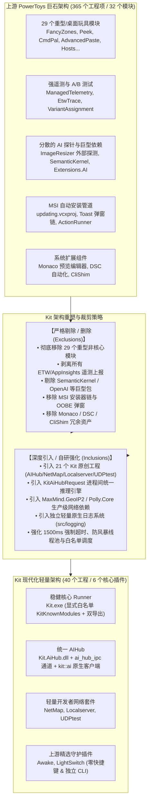
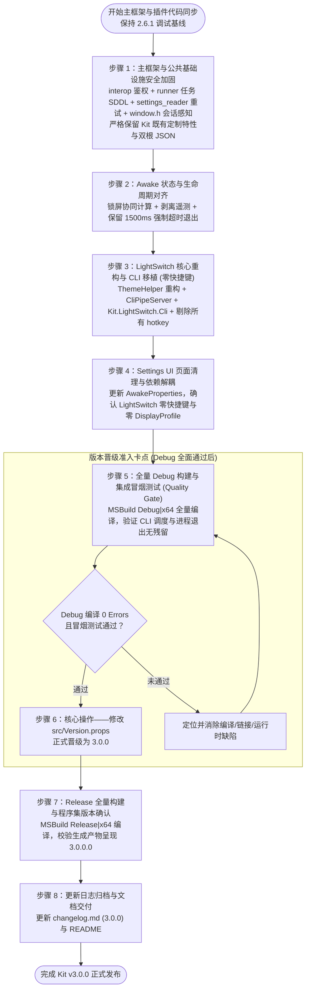

# PowerToys v0.102 上游同步与 Kit v3.0.0 架构升级落地计划书 (Update Plan)

> **版本发布路线**：以当前维护基线 **Kit v2.6.1** 开展代码迁移与调试；**在全量 Debug 构建（0 错误 0 链接警告）与关键功能集成冒烟测试全面通过（Quality Gate）后，正式执行版本跃升至 Kit v3.0.0**。  
> **上游基线**：Microsoft PowerToys Release Train 0.102 (2026.10 稳定版，源码位于 `Source\PowerToys-main`)  
> **实施范围**：主框架（Runner、核心公共库/IPC/设置基础）、Awake 插件、LightSwitch 插件（含全新独立命令行工具 `Kit.LightSwitch.Cli`）。  
> **核心原则**：
> 1. **全链路主框架与安全加固合入**：SDDL 自启动任务权限防御、IPC 管道调用方身份鉴权、设置并发读重试保护、启动时序原子化暂存、系统注销/关机平滑感知；
> 2. **系统性比对引入与删除**：透彻掌握 Kit 相比 PowerToys **引入了哪些原创模块/工程/依赖**，以及**彻底删除了哪些上游重型/冗余模块**，确保同步过程中「不破坏 Kit 原创，不倒退引入上游废弃物」；
> 3. **Awake 状态与生命周期对齐**：锁屏休眠协同（锁屏后允许熄屏且不中断唤醒）；完整保留 Kit 专有的 1500ms 超时等待与 `TerminateProcess` 兜底强制终止逻辑；
> 4. **严格执行零快捷键原则 (Zero-Hotkey Policy)**：**Awake 与 LightSwitch 均不引入、不注册任何全局键盘快捷键代码**，消除低级键盘钩子开销与热键冲突风险；
> 5. **完全解耦外部模块依赖 (PowerDisplay Decoupling)**：彻底剔除上游实验性的 `PowerDisplay.Models` 配置文件联动代码，保证插件自包含；
> 6. **延续 Kit 去中心化与去遥测设计**：继承 `KitModuleIface` 双导出（`kit_create` + `powertoy_create`）、剥离全部 Application Insights / ETW 遥测、沿用 Kit 独立配置目录（`%LOCALAPPDATA%\Kit`）。

---

## 1. Kit 框架与 PowerToys 的引入 (Inclusions) 与删除 (Exclusions) 深度比对

Kit 项目在初始设计时，虽然复用了 PowerToys 的核心 Runner 调度、模块接口协议及 WinUI 3 Settings 交互框架，但在演进过程中进行了深度的「大刀阔斧」改造：**大幅度砍掉大量重型、非核心或带有强遥测捆绑的桌面玩具类模块，同时深度引入自研的开发者网络基础设施与本地/云端统一 AIHub 服务体系**。



---

### 1.1 解决方案工程清单全量比对 (`Kit.slnx` vs `PowerToys.slnx`)

`PowerToys.slnx` 包含了超过 **365 个项目项**（涵盖各类测试项目、CmdPal 扩展套件、安装器及重型依赖），而 `Kit.slnx` 经过深度精简与自研重组，收敛为 **40 个核心工程**：

#### (1) Kit 独有引入的工程清单（21 个工程，严禁被上游改动冲掉）

| 工程类别 | 工程文件路径 | 输出目标 | 核心职责与 Kit 独有特性 |
| :--- | :--- | :--- | :--- |
| **本地开发服务器** | `src\modules\Localserver\LocalserverLib\LocalserverLib.csproj` | `LocalserverLib.dll` | 本地静态站点/反向代理管理核心业务逻辑 |
| | `src\modules\Localserver\LocalserverWorker\LocalserverWorker.csproj` | `LocalserverWorker.dll` | 本地开发服务器后台 Worker 服务 |
| | `src\modules\Localserver\LocalserverModuleInterface\LocalserverModuleInterface.vcxproj` | `Kit.LocalserverModuleInterface.dll` | 供 Runner 加载的 C++ 模块接口适配层（双导出） |
| | `src\modules\Localserver\Localserver.UnitTests\Localserver.UnitTests.csproj` | 单元测试 | 开发服务器路径解析与状态管理测试 |
| **UDP 压力与网络测试** | `src\modules\UDPtest\UDPtestLib\UDPtestLib.csproj` | `UDPtestLib.dll` | UDP 数据包捕获、组播监听与吞吐压力测试 |
| | `src\modules\UDPtest\UDPtestModuleInterface\UDPtestModuleInterface.vcxproj` | `Kit.UDPtestModuleInterface.dll` | 供 Runner 加载的 C++ 模块接口适配层（双导出） |
| | `src\modules\UDPtest\UDPtest.UnitTests\UDPtest.UnitTests.csproj` | 单元测试 | 网络发包与吞吐率统计测试 |
| **网络拓扑与诊断** | `src\modules\NetMap\NetMapLib\NetMapLib.csproj` | `NetMapLib.dll` | 网络路由拓扑映射、MTR 链路抖动诊断与 GeoIP 跨境分类 |
| | `src\modules\NetMap\NetMapModuleInterface\NetMapModuleInterface.vcxproj` | `Kit.NetMapModuleInterface.dll` | 供 Runner 加载的 C++ 模块接口适配层（双导出） |
| | `src\modules\NetMap\NetMap.UnitTests\NetMap.UnitTests.csproj` | 单元测试 | 拓扑计算与 GeoIP 查询单元测试 |
| **自研统一 AI 服务体系** | `src\common\AiHub\Kit.AiHub.csproj` | `Kit.AiHub.dll` | Kit 统一 AI 客户端、Token 计量与任务调度通道 |
| | `src\common\AiHub.UnitTests\Kit.AiHub.UnitTests.csproj` | 单元测试 | AIHub 客户端通信与序列化测试 |
| | `src\modules\AIHub\AIHubLib\Kit.AIHubLib.csproj` | `Kit.AIHubLib.dll` | 本地/云端 LLM 抽象层（OpenAI/Claude/本地模型统一接口） |
| | `src\modules\AIHub\AIHubWorker\AIHubWorker.csproj` | `AIHubWorker.dll` | Settings UI 进程内托管的后台 AI 推理 Worker |
| | `src\modules\AIHub\AIHubModuleInterface\AIHubModuleInterface.vcxproj` | `Kit.AIHubModuleInterface.dll` | 供 Runner 加载的 C++ 模块接口适配层（双导出） |
| **核心启动与互操作层** | `src\runner\Kit.vcxproj` | `Kit.exe` | Kit 核心启动器与进程宿主（替代 upstream `runner.vcxproj`） |
| | `src\common\interop\Kit.Interop.vcxproj` | `Kit.Interop.dll` | 核心跨语言互操作层（替代 upstream `PowerToys.Interop.vcxproj`） |
| | `src\common\Kit.ModuleContracts\Kit.ModuleContracts.csproj` | `Kit.ModuleContracts.dll` | 模块基础服务契约抽象（替代 `PowerToys.ModuleContracts`） |
| | `src\logging\logging.vcxproj` | `spdlog.lib` / 原生静态库 | Kit 专有的原生 Spdlog 构建工程，为全系统提供日志底座 |
| **用户交互与快捷访问** | `src\settings-ui\Settings.UI\Kit.Settings.csproj` | `Kit.Settings.exe` | WinUI 3 设置中心（替代 `PowerToys.Settings.exe`） |
| | `src\settings-ui\QuickAccess.UI\Kit.QuickAccess.csproj` | `Kit.QuickAccess.exe` | 轻量托盘弹出式快速访问中心（替代 upstream QuickAccess） |

#### (2) Kit 彻底删除/未收录的上游工程清单（80+ 个工程项，严禁反向引入）

| 类别 | 彻底删除的工程/模块清单 | 删除依据与架构收益 |
| :--- | :--- | :--- |
| **上游 29 个非核心模块** | `AdvancedPaste`（含 CLI/Engine/Models/Tests）、`AltWindowCycle`、`AlwaysOnTop`、`CmdNotFound`、`ColorPicker`、`CmdPal`（微软重型命令面板，含数十个扩展工程）、`CropAndLock`、`EnvironmentVariables`、`FancyZones`（含 Editor/Lib/Tests）、`FileLocksmith`、`FileExplorer`（SVG/Markdown/PDF/STL/Gcode/QOI 预览扩展）、`MouseUtils`（FindMyMouse/MouseHighlighter/MouseJump/CursorWrap/CursorHide）、`MouseWithoutBorders`、`NewPlus`、`Peek`、`PowerAccent`、`PowerOCR`、`PowerRename`、`PowerDisplay`、`RegistryPreview`、`ShortcutGuide`、`Workspaces`、`ZoomIt`、`GrabAndMove`、`MeasureTool`、`Hosts`、`ImageResizer`、`KeyboardManager`、`PowerLauncher` (PowerToys Run)。 | 彻底移除大量桌面玩具类与老旧 Shell 扩展，减少 80% 以上的代码编译量与常驻内存开销，避免低级系统钩子引发卡顿。 |
| **上游 AI/模型外部包** | `LanguageModelProvider`：上游针对个别模块分散引入的零散模型提供者。 | 架构冲突。Kit 拥有全系统统一的 `Kit.AiHub` 基础设施，杜绝上游分散的 AI 探针。 |
| **上游遥测与实验体系** | `ManagedTelemetry.csproj`、`EtwTrace.vcxproj`、`Microsoft.VariantAssignment`。 | 彻底清除所有上报至微软云端的隐私追踪代码与 A/B 实验客户端，实现 100% 本地纯净运行。 |
| **上游自动更新器体系** | `updating.vcxproj`、`PowerToys.Update.vcxproj`。 | 移除依赖 MSI 管道与 Windows Toast 通知的复杂自动安装器，保留 Kit 针对自身 GitHub Releases 的轻量化 JSON 检测。 |
| **上游系统运维与测试** | `dsc` (Desired State Configuration 自动化配置工程)、`UITestAutomation.Next` (WinAppDriver 重型测试框架)、`CliShim` (全局命令行垫片)、`Monaco` (Web 代码编辑器)。 | 移除仅供企业大规模策略分发或重型自动化使用的多余资产，降低依赖复杂度。 |

---

### 1.2 核心 Runner 框架差异化深度比对 (Core Runner Framework Comparison)

| 架构维度 | 上游 PowerToys 框架实现 | Kit 现代化重构实现 | 同步合并关键防线 |
| :--- | :--- | :--- | :--- |
| **模块发现机制** | 动态扫描模块目录或维护数十个模块的冗长列表。 | **编译期显式白名单 `KitKnownModules`**：<br/>仅收录 Awake、LightSwitch、Localserver、UDPtest、NetMap、AIHub。 | **严禁引入动态扫描**，`main.cpp` 必须保留 `KitKnownModules` 显式数组与 `is_known_module_registered`。 |
| **模块导出 ABI** | 仅导出 `powertoy_create`。 | **双导出优先机制**：<br/>优先查找 `kit_create`，未找到时向下兼容 `powertoy_create`。 | 保留 `kit_module.cpp` 中的双导出解析，保证 Kit 原创模块与移植模块均可平滑调度。 |
| **AI 推理服务通信** | 无全局统一通道；通过 `DetectAiCapabilitiesAsync` 外部探针探测 ImageResizer。 | **Runner 统一导出 `KitAiHubRequest` C-API**：<br/>`kit::ai::request` 原生客户端 -> Runner 管道分发 -> `settings_window.cpp` 拦截 -> `AIHubWorker` 执行。 | **严禁引入** `DetectAiCapabilitiesAsync`，保留 `ai_hub_ipc.cpp/.h` 与 `try_complete_ai_hub_response(msg)`。 |
| **进程生命周期守护** | 标准 Windows 事件通知，退出时简单等待进程句柄。 | **1500ms 强制超时与 `TerminateProcess` 兜底**：<br/>Settings、Awake、LightSwitch 超时未退出立即强杀。 | 保留所有 1500ms 进程等待循环与 `TerminateProcess` 兜底代码，彻底避免后台残留僵尸进程。 |
| **快速访问主机 (QuickAccess)** | 直接拉起进程并等待，缺乏高频点击防风暴保护。 | **线程池任务去抖动与作业对象隔离**：<br/>`wil::unique_threadpool_work show_work` + `std::atomic_bool show_pending` + `quick_access_job`。 | 保持 `quick_access_host.cpp` 既有去抖动逻辑不变，杜绝高频呼出崩溃。 |
| **URI 协议解析** | 仅支持 `powertoys://` 协议。 | **双协议解析**：<br/>同时支持 `kit://` 与 `powertoys://`。 | 保留 `get_uri_protocol_payload` 中的双协议头判定。 |
| **自启动计划任务** | 任务存放于计划任务根目录 `\PowerToys`。 | 任务严格存放于独立目录 **`\Kit`**。 | 合入上游 SDDL 权限防提权加固的同时，**必须保留 `KIT_TASK_SCHEDULER_FOLDER = L"\\Kit"`**。 |
| **系统注销/关机感知** | 处理 `WM_QUERYENDSESSION` / `WM_ENDSESSION` 并置位 `g_system_session_ending`。 | 既有代码未处理，关机时可能触发系统等待超时警告。 | **完整采纳**：在 `src\common\utils\window.h` 增加 `handle_stateless_session_end_message`，并在 `tray_icon.cpp` 中接入。 |
| **全局热键注册与分发** | 容易受到按键长按连击触发风暴；分发时未验证 map 迭代器有效性。 | 追加 `MOD_NOREPEAT`；使用 `actions.find(shortcut)` 安全检索后分发。 | **完整采纳**：将上游热键安全补丁合入 `src\runner\centralized_hotkeys.cpp`。 |
| **设置读取并发防御** | 读取 `settings.json` 时若恰逢 Settings.UI 正在写入可能读到空内容。 | 增加带指数退避的并发重试机制 `load_from_file_checked`。 | **完整采纳**：引入 `general_settings_reader.h` 并改造 `general_settings.cpp`。 |

---

### 1.3 设置中心与 UI 层差异比对 (Settings UI Comparison)

| 比对维度 | 上游 PowerToys 设置中心 | Kit 现代化设置中心 | 同步合并防线 |
| :--- | :--- | :--- | :--- |
| **IPC 数据根节点** | 仅下发 `{ "powertoys": { ... }, "general": { ... } }`。 | **双根下发**：<br/>`{ "kit": { ... }, "powertoys": { ... }, "general": { ... } }`。 | 保留 `settings_window.cpp` 中的 `result.SetNamedValue(L"kit", moduleSettings);`。 |
| **页面收录清单 (Views)** | 39 个 XAML 页面（含 FancyZonesPage, CmdPalPage, PowerDisplayPage, ProfileEditor 等）。 | **精简为 11 个页面**：<br/>Dashboard, General, Awake, LightSwitch, SearchResults, Shell, **AIHubPage, LocalserverPage, NetMapPage, UDPtestPage, FindingDetailsDialog**。 | 严禁反向复制上游 29 个废弃模块的 XAML 与 ViewModel；严禁引入 PowerDisplay 及其对话框。 |
| **数据持久化根路径** | 硬编码 `%LOCALAPPDATA%\Microsoft\PowerToys`。 | 动态绑定 `CommonSharedConstants::APPDATA_PATH`，固定为 **`%LOCALAPPDATA%\Kit`**。 | 保持 `settings_helpers.cpp` 中的 `APPDATA_PATH` 宏引用，严禁恢复为微软路径。 |
| **诊断与遥测开关** | 在注册表 `HKCU\Software\Classes\PowerToys` 写入 `AllowDataDiagnostics`。 | `save_data_diagnostics(bool enabled)` **保持完全空操作**。 | 保留空实现，防止向注册表写入无用的微软遥测标记。 |

---

### 1.4 公共库与安全层差异比对 (Common Libraries & Security Comparison)

| 模块组件 | 上游 PowerToys 实现 | Kit 现代化实现 | 同步合并防线 |
| :--- | :--- | :--- | :--- |
| **跨进程管道鉴权** | 管道缺乏对端安全校验，任何本地进程均可连接并冒充 UI 发送命令。 | 引入 `pipe_caller_auth.h/.cpp`，校验连接方 PID、Token User 及 Logon SID。 | **完整采纳**：将 `pipe_caller_auth.*` 移植至 `src\common\interop\`，并更新 `two_way_pipe_message_ipc`。 |
| **管道客户端安全标志** | 客户端连接未显式限制模拟级别。 | 定义 `ClientOpenFlags = FILE_FLAG_OVERLAPPED \| SECURITY_SQOS_PRESENT \| SECURITY_IDENTIFICATION`。 | **完整采纳**：合入 `two_way_pipe_message_ipc.h`，防止特权提升攻击。 |
| **日志记录系统** | 依赖外部包或混合 NLog 与 Spdlog。 | 拥有独立自研工程 `src\logging\logging.vcxproj`，纯原生 Spdlog 构建，日志定向至 `%LOCALAPPDATA%\Kit\Logs`。 | 保持 `logging.vcxproj` 构建架构不变，保持 `Logger::init` 中的 `Kit\Logs` 路径。 |
| **共享常量定义 (`shared_constants.h`)** | 包含 30 多个模块的上百个命名事件 GUID 与消息字符串。 | **大幅精简**：仅保留 Settings 退出事件、Awake 退出事件及 `APPDATA_PATH = L"Kit"`。 | 严禁将上游庞大的事件列表反向覆盖进 Kit 的 `shared_constants.h`。 |
| **模块服务抽象** | `PowerToys.ModuleContracts.csproj`。 | `Kit.ModuleContracts.csproj`（提供 `IModuleService` 与 `OperationResult`）。 | 保持 Kit 自身命名空间与程序集引用。 |

---

### 1.5 NuGet 依赖包全量比对 (`Directory.Packages.props`)

| 依赖类别 | Kit 独有引入包 (Kit Only) | PowerToys 引入但 Kit 坚决不引入 (Omitted by Kit) | 同步决策 |
| :--- | :--- | :--- | :--- |
| **网络与容错** | `MaxMind.GeoIP2` (IP 地理定位库)<br/>`Polly.Core` (请求弹性重试与熔断策略) | *无* | **保留 Kit 独有依赖**，NetMap 模块核心依赖。 |
| **C++ / 运行时** | `boost_regex-vc143`<br/>`Microsoft.Windows.Compatibility` | `Microsoft.WindowsPackageManager.ComInterop` | **保留 Kit 独有依赖**，提供原生正则与 Windows 兼容性支持。 |
| **AI 推理引擎** | *Kit 统一在 `Kit.AiHub` 中自研封装* | `Microsoft.SemanticKernel.*`<br/>`Microsoft.Extensions.AI.*`<br/>`OpenAI`<br/>`Microsoft.AI.Foundry.Local` | **坚决不引入上游 AI 包**！避免数十兆的 SemanticKernel 及其连接器污染 Kit 依赖树。 |
| **UI 与控件库** | *保持 WinUI 3 / CommunityToolkit 基础卡片* | `AdaptiveCards.*` (自适应卡片)<br/>`ControlzEx`<br/>`HelixToolkit.*` (3D 渲染)<br/>`ModernWpfUI` | **坚决不引入**，Kit 仅保留 WinUI 3 核心控件，杜绝多套 UI 渲染框架混用。 |
| **遥测与实验** | *无（零遥测）* | `Microsoft.Diagnostics.Tracing.TraceEvent`<br/>`Microsoft.VariantAssignment.*` (A/B 测试实验客户端) | **坚决不引入**，彻底维护 Kit 的静默与隐私纯净度。 |
| **日志框架** | *统一采用 Spdlog 原生日志与 ManagedCommon* | `NLog`<br/>`NLog.Extensions.Logging` | **坚决不引入**，避免双重日志系统冲突。 |

---

### 1.6 上游 PowerToys v0.102 变动「采纳与拒绝」决策矩阵 (v0.102 Decision Matrix)

| 上游 v0.102 变动项 | 变动文件/模块 | 落地决策 | 决策依据与处理方式 |
| :--- | :--- | :---: | :--- |
| **自启动任务 SDDL 访问控制** | `src\runner\auto_start_helper.cpp` | **采纳合入** | **安全加固**：通过 SDDL 显式限定计划任务所有权与修改权限，杜绝普通用户本地提权（LPE）漏洞。保持 `\Kit` 任务路径。 |
| **IPC 管道调用者身份鉴权** | `src\common\interop\pipe_caller_auth.*` | **采纳合入** | **安全加固**：增加 `VerifyPipeCaller` 校验调用进程 PID、Token 与 Logon SID，防止本机非授权进程模拟或探测 Runner 管道。 |
| **全局热键 MOD_NOREPEAT 与安全查找**| `src\runner\centralized_hotkeys.cpp` | **采纳合入** | **稳定性提升**：注册热键追加 `MOD_NOREPEAT` 防长按连击风暴，分发查找使用安全迭代器防越界崩溃。 |
| **设置并发读取重试保护** | `src\runner\general_settings_reader.h` | **采纳合入** | **健壮性提升**：带重试的 `load_from_file_checked` 解决 Settings.UI 写入与 Runner 读取之间的文件锁竞态。 |
| **设置窗口延迟加载暂存器** | `src\runner\settings_window_startup.h` | **采纳合入** | **启动优化**：在各模块初始化完成前暂存打开请求，初始化完成后原子化唤起，避免启动期白屏或事件丢失。 |
| **系统关机/注销会话感知** | `src\common\utils\window.h` & `tray_icon.cpp` | **采纳合入** | **平滑退出**：引入 `handle_stateless_session_end_message` 并记录 `WM_QUERYENDSESSION` / `WM_ENDSESSION`，置位 `g_system_session_ending`，避免关机触发挂起。 |
| **Awake 锁屏熄屏与唤醒协同** | `src\modules\awake\Awake\Core\` | **采纳合入** | **功能优化**：锁屏时允许屏幕按系统策略熄灭，同时计算核心维持唤醒（`ES_SYSTEM_REQUIRED`），避免离开工位无谓耗电。 |
| **LightSwitch 核心重构与夜间模式防御**| `src\modules\LightSwitch\LightSwitchLib\` | **采纳合入** | **可靠性重构**：`ThemeHelper` 错误码现代化（`LSTATUS`），夜间模式注册表读取增加 25B~64KB 内存安全边界防御。 |
| **LightSwitch.Cli 独立命令行工具** | `src\modules\LightSwitch\LightSwitch.Cli\` | **改写采纳** | **功能扩展**：移植独立的 C# 命令行客户端，适配预期服务端名为 `Kit.LightSwitchService.exe`，剔除遥测包。 |
| **LightSwitchService 管道与队列** | `src\modules\LightSwitch\LightSwitchService\` | **采纳合入** | **架构对齐**：合入 `CliPipeServer`、`CliIdentity` 与 `ScheduleCommandQueue`，**保留 Kit 命名退出事件**。 |
| **Awake / LightSwitch 快捷键代码** | 模块接口、Settings.UI、配置类、测试集 | **坚决拒绝/剔除** | **零快捷键原则**：彻底不移植 `toggle-theme-hotkey`、`m_toggle_theme_hotkey`、`ShortcutControl`，保持后台守护纯净。 |
| **LightSwitch PowerDisplay 配置文件联动**| `LightSwitchProfileReferenceHelper.cs` 等 | **坚决拒绝/剔除** | **依赖解耦**：Kit 未收录 PowerDisplay 模块，彻底剔除 `PowerDisplay.Models` 强引用，避免引发编译崩溃。 |
| **Runner ImageResizer AI 能力探测** | `main.cpp` (`DetectAiCapabilitiesAsync`) | **坚决拒绝** | **架构冲突**：Kit 拥有自研统一的 `AIHub`，严禁通过调用未收录的 ImageResizer 进行外部探测。 |
| **上游 ETW / AppInsights 遥测注入** | 所有涉及 Telemetry 的类与项目 | **坚决拒绝** | **隐私与去中心化**：Runner 的 `trace.cpp` 保持空实现，C# 代码删除所有 `PowerToysTelemetry` 调用。 |
| **上游 MSI / Toast 自动更新安装器** | `UpdateUtils.cpp`, `updating.vcxproj` | **坚决拒绝** | **保持 Kit 定制**：保留 Kit 自身针对独立仓库的轻量化 JSON 版本检测。 |

---

## 2. Kit 主框架历史定制深度防御 (Framework Customization Preservation)

### 2.1 主框架各文件精确合并指引 (Runner & Common)

#### (1) `src\runner\main.cpp`
* **Kit 既有定制资产（必须保留）**：
  - 核心常量：`KIT_DISPLAY_NAME` = L"Kit"、`KIT_RUNNER_TITLE` = L"Kit - runner"；
  - 双协议解析：`get_uri_protocol_payload` 支持 `kit://` 与 `powertoys://`；
  - 模块显式白名单注册：
    ```cpp
    constexpr std::wstring_view KitKnownModules[] = {
        L"Kit.AwakeModuleInterface.dll",
        L"Kit.LightSwitchModuleInterface.dll",
        L"Kit.LocalserverModuleInterface.dll",
        L"Kit.UDPtestModuleInterface.dll",
        L"Kit.NetMapModuleInterface.dll",
        L"Kit.AIHubModuleInterface.dll",
    };
    ```
  - 模块加载调用 `load_kit_module`；
* **合并动作**：仅合入 `auto_start_helper` 相关的初始化安全参数；**严禁合入** `DetectAiCapabilitiesAsync`、`clean_video_conference`、`EtwTrace` 及上游遥测头文件。

#### (2) `src\runner\settings_window.cpp` & `settings_window_startup.h`
* **Kit 既有定制资产（必须保留）**：
  - 双根节点 JSON 配置下发：`result.SetNamedValue(L"kit", moduleSettings); result.SetNamedValue(L"powertoys", moduleSettings);`
  - AI Hub 跨进程拦截处理：
    ```cpp
    if (try_complete_ai_hub_response(msg)) {
        return;
    }
    ```
  - 独立的生命周期管理线程 `settings_thread` 与 `settings_shutdown_event`，防止 UI 线程阻塞；
  - 退出超时与强杀：1500ms `WaitForSingleObject` 超时后执行 `TerminateProcess`。
* **合并动作**：引入 `settings_window_startup.h` 在模块未就绪前暂存打开请求；完整保留 `try_complete_ai_hub_response`、双根 JSON 结构与强杀保护。

#### (3) `src\runner\general_settings.cpp` & `general_settings_reader.h`
* **Kit 既有定制资产（必须保留）**：引用 `kit_module.h` 并调用 `modules()`；默认禁用更新 Toast 与预览版更新。
* **合并动作**：引入 `general_settings_reader.h` 并调用带重试的 `load_from_file_checked`；保持 `kit_module.h`，严禁引入 `ai_detection.h`。

#### (4) `src\runner\centralized_hotkeys.cpp`
* **合并动作**：
  - 注册热键追加 `MOD_NOREPEAT`：`RegisterHotKey(runnerWindow, ids[shortcut], shortcut.modifiersMask | MOD_NOREPEAT, shortcut.vkCode)`；
  - 分发热键过滤 `MOD_NOREPEAT` 标志，并改用 `actions.find(shortcut)` 安全迭代器检索，杜绝热键连击风暴与未映射按键崩溃。

#### (5) `src\runner\centralized_kb_hook.cpp`
* **Kit 既有定制资产（必须保留）**：剥离了上游冗长的长按 Win 键计时器与 `PressedKeyDescriptor`，保持极度轻量与超低输入延迟。
* **合并动作**：**保持 Kit 现有实现不变**，严禁反向合入针对废弃模块的 Win 键计时器代码。

#### (6) `src\runner\tray_icon.cpp`
* **Kit 既有定制资产（必须保留）**：文档链接指向 `https://github.com/guijianchou/Kit`；移除了 Bug Report 弹窗与 About 弹窗；保留 Kit 模块菜单排版。
* **合并动作**：合入 `g_system_session_ending` 标志、`log_session_end_message` 以及调用 `handle_stateless_session_end_message`，平滑注销/关机流程；保留 Kit 文档链接与菜单项。

#### (7) `src\runner\quick_access_host.cpp`
* **Kit 既有定制资产（必须保留）**：管道名 `kit_quick_access_runner_`；事件名 `Local\KitQuickAccess_`；独创 `wil::unique_threadpool_work show_work` 结合 `show_pending` 防风暴线程池逻辑；通过 `quick_access_job` 绑定子进程生命周期。
* **合并动作**：**保持 Kit 现有实现不变**。

#### (8) `src\runner\auto_start_helper.cpp`
* **合并动作**：完整移植 `get_auto_start_task_sddl()`，通过 SDDL 严格限制计划任务修改权限（仅限 Local System、Admin 组与当前 User，杜绝 LPE 提权）；**保留 Kit 任务文件夹 `KIT_TASK_SCHEDULER_FOLDER = L"\\Kit"`**。

#### (9) `src\runner\UpdateUtils.cpp`
* **Kit 既有定制资产（必须保留）**：完全重写的轻量化 JSON 检测，去除了所有安装器捆绑。
* **合并动作**：**保持 Kit 现有实现不变**，严禁引入上游 MSI 下载与安装器代码。

#### (10) `src\common\utils\window.h`
* **合并动作**：移植 `handle_stateless_session_end_message(HWND window, UINT message, WPARAM wparam, LPARAM lparam, LRESULT& out_result, bool* out_system_session_ending)`，使得无状态窗口在收到关机/注销消息时即时 DestroyWindow 并 PostQuitMessage，避免触发 Windows 的 `APPLICATION_HANG_QUIESCE`。

#### (11) `src\common\interop\` 管道安全体系
* **Kit 既有定制资产（必须保留）**：工程名 `Kit.Interop.vcxproj`，输出 `Kit.Interop.dll`；`shared_constants.h` 维持 `APPDATA_PATH = L"Kit"`；包含 Kit 原创的 `ai_hub_client.h`。
* **合并动作**：
  - 移植 `pipe_caller_auth.h/.cpp` 至 `src\common\interop\` 并加入 `Kit.Interop.vcxproj`；
  - `two_way_pipe_message_ipc.h/.cpp` 合入 `ClientOpenFlags`，合入双重重载 `start(HANDLE token, const interop_auth::CallerPolicy& caller_policy)`，合入替换监听器机制与 `reap_finished_connection_handlers`；
  - 保证与 `ai_hub_client.h` 兼容共存。

#### (12) `src\common\SettingsAPI\settings_helpers.cpp/.h`
* **Kit 既有定制资产（必须保留）**：数据根目录绑定 `CommonSharedConstants::APPDATA_PATH`（指向 `%LOCALAPPDATA%\Kit`，严禁写死 `Microsoft\PowerToys`）；`save_data_diagnostics` 保持空操作。
* **合并动作**：移植 `get_oobe_opened_state`、`save_oobe_opened_state`、`get_last_version_run`、`save_last_version_run` 等辅助方法，内部统一调用 `PTSettingsHelper::get_root_save_folder_location()`。

---

## 3. Awake & LightSwitch 插件落地细化 (零快捷键与解耦版)

### 3.1 Awake 插件落地要点
1. **锁屏状态与屏幕协同 (`Awake\Core\`)**：
   - 保持 `AwakeStateCalculator.ComputeAwakeState(keepDisplayOn, IsScreenLocked)`：在屏幕锁定时允许屏幕按系统策略熄灭，同时计算核心维持唤醒（`ES_SYSTEM_REQUIRED`）；
   - 移除所有 `PowerToysTelemetry` 调用与相关 using；保留 `--use-kit-config` 参数与 `IsUsingKitConfig`。
2. **C++ 模块接口层 (`AwakeModuleInterface\dllmain.cpp`)**：
   - 继承 `KitModuleIface`，导出 `kit_create()` 与 `powertoy_create()`；
   - **严格剔除任何快捷键注册**（不重写 `get_hotkeys` / `on_hotkey`）；
   - **严格保留 Kit 现有的 1500ms 超时等待与 `TerminateProcess` 强制终止机制**，防止退出残留：
     ```cpp
     constexpr DWORD AWAKE_SHUTDOWN_WAIT_MS = 1500;
     void terminate_process_if_running() {
         if (!is_process_running()) return;
         Logger::warn(L"Kit Awake did not exit after shutdown signal; terminating process.");
         if (!TerminateProcess(p_info.hProcess, 1)) {
             Logger::warn(L"Failed to terminate Kit Awake. {}", get_last_error_or_default(GetLastError()));
             return;
         }
         WaitForSingleObject(p_info.hProcess, AWAKE_SHUTDOWN_WAIT_MS);
     }
     ```
3. **设置层 (`AwakeProperties.cs`)**：
   - `CustomTrayTimes` 增加 `init` 访问器并提供防空初始化。

---

### 3.2 LightSwitch 插件落地要点 (零快捷键 & 独立 CLI)
1. **`LightSwitchLib\ThemeHelper.cpp/.h` 现代化重构**：
   - 全面合入上游现代重构：
     - `TryGetSystemTheme` / `TryGetAppsTheme` / `TrySetSystemTheme` / `TrySetAppsTheme` 统一返回 `LSTATUS` 错误码；
     - `ReadNightLightState` 增加 25B 最小边界与 64KB 最大边界安全检查，防御 CloudStore 注册表竞态；
   - 保留对系统与应用主题切换的广播通知（`WM_SETTINGCHANGE`, `WM_THEMECHANGED`）。
2. **`LightSwitchService` 升级与 CLI 管道服务**：
   - 移植 `CliIdentity.h/.cpp`（验证管道连接进程的 Token User 与 Logon SID，防止仿冒）；
   - 移植 `CliPipeServer.h/.cpp`（命令管道服务端，管道名统一对齐为 `Kit_LightSwitch_Cli_<SessionID>`）；
   - 移植 `CliProtocol.h/.cpp`（CLI JSON 协议编解码）；
   - 移植 `ScheduleCommandQueue.h`（命令排队队列，保证异步切换线性化）；
   - 移植 `LocalizedStrings.h`、`resource.base.h`、`Resources.resx`，并在 `LightSwitchService.vcxproj` 中接入 `convert-resx-to-rc.ps1` 预编译生成；
   - **必须保留 Kit 专用的命名退出事件与手动覆盖事件**：
     ```cpp
     const wchar_t KIT_LIGHTSWITCH_MANUAL_OVERRIDE[] = L"Local\\KitLightSwitchManualOverrideEvent-55af6d42-c0e1-4f09-9a2c-b7cb8fdfb5a2";
     const wchar_t KIT_LIGHTSWITCH_SERVICE_STOP[] = L"Local\\KitLightSwitchServiceStopEvent-09b983c3-01df-4490-9f84-9f6e5c52c7d5";
     ```
   - 追加 `RuntimeObject.lib` 依赖，编译目标维持 `Kit.LightSwitchService.exe`。
3. **`LightSwitchModuleInterface\dllmain.cpp` 零快捷键精简**：
   - **严格剔除 `m_toggle_theme_hotkey`**；
   - **严格不实现 `get_hotkeys` 与 `on_hotkey`**；
   - **严格不解析 `toggle-theme-hotkey` JSON 节点**；
   - 保持作为 KitRunner 与 LightSwitchService 之间的生命周期守护者，保留 1500ms 服务退出等待机制。
4. **移植全新 `LightSwitch.Cli` 命令行工具**：
   - 拷贝上游目录至 `src\modules\LightSwitch\LightSwitch.Cli\`；
   - `LightSwitch.Cli.csproj`：
     - `<AssemblyName>Kit.LightSwitch.Cli</AssemblyName>`；
     - `<Platforms>x64</Platforms>`（移除 ARM64）；
     - 移除 `ManagedTelemetry.csproj` 引用；
   - **关键修正 (`Ipc\PipeServerIdentity.cs`)**：
     ```csharp
     // 必须修正为 Kit 服务端文件名，否则进程名校验失败导致 CLI 报 Error_UntrustedServer
     internal static string ExpectedServerPath => Path.Combine(AppContext.BaseDirectory, "LightSwitchService", "Kit.LightSwitchService.exe");
     ```
   - `Protocol\CliProtocol.cs`：管道名称与 `CliPipeServer.cpp` 对齐为 `Kit_LightSwitch_Cli_`；
   - 移除 `CliApplication.cs` 中的遥测上报，纯粹保留 CLI 命令与管道交互；
   - 将项目纳入 `Kit.slnx` 并在 `Kit.vcxproj` 建立构建依赖。
5. **Settings UI 页面与 ViewModel 彻底解耦**：
   - `LightSwitchProperties.cs`：**严禁添加 `ToggleThemeHotkey`**，**严禁添加 PowerDisplay 属性**；
   - `LightSwitchPage.xaml`：**严禁添加 `ShortcutControl`**，**严禁添加 DisplayProfile 控件**；
   - `LightSwitchViewModel.cs`：**严禁添加 `ToggleThemeActivationShortcut`**，**严禁引入 PowerDisplay 加载逻辑**。

---

## 4. 实施路线图与质量晋级卡点 (Execution Plan & Quality Gates)



---

### 分阶段执行细节

#### 步骤 1：主框架与公共库安全加固（保持 2.6.1）
1. 拷贝 `pipe_caller_auth.h/.cpp` 至 `src\common\interop\`，更新 `Kit.Interop.vcxproj`，更新 `two_way_pipe_message_ipc`；
2. 更新 `src\common\utils\window.h` 合入 `handle_stateless_session_end_message`；
3. 更新 `src\runner\auto_start_helper.cpp` 合入 `get_auto_start_task_sddl()` 计划任务权限加固，保留 `\Kit` 路径；
4. 更新 `src\runner\centralized_hotkeys.cpp` 合入 `MOD_NOREPEAT` 与安全查找迭代器；
5. 引入 `general_settings_reader.h` 与 `settings_window_startup.h` 到 `src\runner\`；
6. 更新 `settings_window.cpp`，**保留 `try_complete_ai_hub_response(msg)`、`kit`/`powertoys` 双 JSON 根与 1500ms 强杀保护**；
7. 更新 `tray_icon.cpp` 合入 `g_system_session_ending`、会话结束日志并接入无状态关机处理，保留 Kit 菜单排版；
8. 更新 `src\common\SettingsAPI\settings_helpers.*` 合入 OOBE/Version 辅助方法，**保留 `CommonSharedConstants::APPDATA_PATH` 与空遥测**。

#### 步骤 2：Awake 模块状态同步与生命周期强化
1. 对齐 `AwakeStateCalculator` 锁屏状态机，剥离 `Manager.cs` 中的遥测；
2. 审查 `AwakeModuleInterface\dllmain.cpp`，确认无快捷键代码，保留 1500ms 超时强制终止逻辑；
3. 更新 `AwakeProperties.cs`。

#### 步骤 3：LightSwitch 核心重构与 CLI 移植 (零快捷键)
1. 替换 `LightSwitchLib\ThemeHelper.cpp/.h` 为现代化错误码与边界防御版本；
2. `LightSwitchService` 引入 `CliIdentity`、`CliPipeServer`、`CliProtocol`、`ScheduleCommandQueue`、`LocalizedStrings` 及资源模板；
3. `LightSwitchModuleInterface\dllmain.cpp` 剔除所有快捷键代码（不定义 `m_toggle_theme_hotkey`，不实现 `get_hotkeys`/`on_hotkey`）；
4. 移植 `LightSwitch.Cli`，修改 AssemblyName 为 `Kit.LightSwitch.Cli`，修正 `PipeServerIdentity.cs` 的预期服务端路径为 `Kit.LightSwitchService.exe`，剔除 Telemetry；
5. 在 `Kit.slnx` 中包含 `LightSwitch.Cli.csproj` 并设置 `Kit.vcxproj` 构建依赖。

#### 步骤 4：Settings UI 页面清理与依赖解耦
1. 清理 `LightSwitchProperties.cs`（无 `ToggleThemeHotkey`，无 PowerDisplay 属性）；
2. 清理 `LightSwitchPage.xaml`（无 `ShortcutControl`，无 DisplayProfile 控件）；
3. 清理 `LightSwitchViewModel.cs`（无 `ToggleThemeActivationShortcut`，无 PowerDisplay 逻辑）。

#### 步骤 5：全量 Debug 构建与集成冒烟测试 (Quality Gate)
使用本地 MSBuild 工具链执行全量 Debug 构建：
```powershell
& "C:\Program Files\Microsoft Visual Studio\18\Enterprise\MSBuild\Current\Bin\amd64\MSBuild.exe" Kit.slnx `
  /p:Platform=x64 /p:Configuration=Debug /verbosity:normal `
  /clp:Summary;PerformanceSummary;ErrorsOnly;WarningsOnly `
  /nologo /nodeReuse:false /m `
  /p:PowerToysSkipCopyOnWriteSdk=true /p:PowerToysSkipRunVSTestSdk=true
```
**冒烟验证 Checklist**：
- [x] 构建日志确认：**0 Errors**；
- [x] 运行 `.\x64\Debug\Kit.LightSwitch.Cli.exe status --json`，验证管道连通并输出正确 JSON；
- [x] 运行 `.\x64\Debug\Kit.LightSwitch.Cli.exe toggle`，验证主题即时反转；
- [x] 启动 `Kit.exe`，使用热键工具检查系统注册热键，确认 Awake 与 LightSwitch **均未注册任何全局键盘快捷键**；
- [x] 退出 Kit，验证任务管理器中 `Kit.exe`、`Kit.Awake.exe`、`Kit.LightSwitchService.exe` 在 1500ms 内全部干净终止，无残留进程；
- [x] 运行 Awake 与 Settings.UI 单元测试：100% 通过；

#### 步骤 6：Debug 通过后——正式晋级版本至 3.0.0
**在步骤 5 全面绿灯确认后，执行版本跃升**：
1. 修改 `src\Version.props`：
   ```xml
   <?xml version="1.0" encoding="utf-8"?>
   <Project ToolsVersion="4.0" xmlns="http://schemas.microsoft.com/developer/msbuild/2003">
     <PropertyGroup>
       <Version>3.0.0</Version>
       <!-- Forcing for every DLL on by default -->
       <ChecksumAlgorithm>SHA256</ChecksumAlgorithm>
     </PropertyGroup>
   </Project>
   ```

#### 步骤 7：Release 全量构建与产物校验
执行最终交付构建：
```powershell
& "C:\Program Files\Microsoft Visual Studio\18\Enterprise\MSBuild\Current\Bin\amd64\MSBuild.exe" Kit.slnx `
  /p:Platform=x64 /p:Configuration=Release /verbosity:normal `
  /clp:Summary;PerformanceSummary;ErrorsOnly;WarningsOnly `
  /nologo /nodeReuse:false /m `
  /p:PowerToysSkipCopyOnWriteSdk=true /p:PowerToysSkipRunVSTestSdk=true
```
校验产物版本号：
```powershell
(Get-Item ".\x64\Release\Kit.exe").VersionInfo.ProductVersion                          # 预期输出: 3.0.0.0
(Get-Item ".\x64\Release\Kit.Awake.exe").VersionInfo.ProductVersion                    # 预期输出: 3.0.0.0
(Get-Item ".\x64\Release\Kit.LightSwitch.Cli.exe").VersionInfo.ProductVersion          # 预期输出: 3.0.0.0
(Get-Item ".\x64\Release\LightSwitchService\Kit.LightSwitchService.exe").VersionInfo.ProductVersion # 预期输出: 3.0.0.0
```

#### 步骤 8：更新日志归档与文档交付
1. 在 `changelog.md` 顶部增加 `3.0.0` 章节（中英双语）：
   - 主框架安全加固（SDDL 任务权限防提权、管道鉴权机制、设置并发重试、系统注销平滑退出）；
   - Awake 锁屏状态感知与屏幕休眠协同；
   - LightSwitch 核心重构与全新 `Kit.LightSwitch.Cli` 命令行工具；
   - 标注 Awake 与 LightSwitch 实行零快捷键轻量化设计。
2. 在 `README.md` 与 `README_zh.md` 中更新版本号为 `3.0.0`，并补充 `Kit.LightSwitch.Cli.exe` 的命令行调用示例。

---

## 5. 质量保证与验证矩阵 (Verification Matrix)

| 测试项目 | 触发命令 / 验证方式 | 预期结果 |
| :--- | :--- | :--- |
| **Debug 编译质量卡点** | `MSBuild Kit.slnx /p:Configuration=Debug /p:Platform=x64` | **0 Errors**，全量项目成功输出到 `x64\Debug\`。 |
| **热键干净度验证** | 启动 Kit，使用热键检测工具枚举当前系统注册的全局热键 | **没有任何针对 Awake 和 LightSwitch 的全局快捷键**。 |
| **LightSwitch CLI 状态查询** | `.\x64\Debug\Kit.LightSwitch.Cli.exe status --json` | 返回格式化 JSON，输出主题模式、日程模式及夜间模式状态。 |
| **LightSwitch CLI 即时切换** | `.\x64\Debug\Kit.LightSwitch.Cli.exe toggle` | 系统与应用主题即时完成反转切换，退出代码为 `0`。 |
| **LightSwitch CLI 日程配置** | `.\x64\Debug\Kit.LightSwitch.Cli.exe schedule enable --mode SunsetToSunrise` | 日程模式设置为日落到日出，设置文件与 UI 立即同步。 |
| **Awake 锁屏熄屏行为** | 开启 Awake "保持屏幕开启"，按 `Win+L` 锁屏等待系统超时 | 屏幕按系统锁屏策略正常熄灭，后台任务保持计算，解锁后状态自动恢复。 |
| **托盘退出进程干净度** | 托盘菜单点击 "退出 Kit" | 任务管理器中 `Kit.exe`、`Kit.Awake.exe`、`Kit.LightSwitchService.exe` 全部干净终止，无遗留驻留。 |
| **版本号晋级生效校验 (阶段6)**| `(Get-Item .\x64\Release\Kit.exe).VersionInfo.ProductVersion` | 产品版本与文件版本均严格显示为 `3.0.0.0`。 |
| **单元测试回归** | `dotnet test Kit.slnx --filter "FullyQualifiedName!~UITests"` | 所有非 UI 单元测试用例 100% 通过。 |

---

## 6. 执行里程碑检查表 (Milestones Checklist)

- [x] **M1 (主框架与基础设施安全就绪 - 2.6.1 调试期)**
  - [x] `src\common\interop` 移植 `pipe_caller_auth` 并通过编译，保留 `ai_hub_client.h`
  - [x] `src\common\interop\two_way_pipe_message_ipc` 合入 `ClientOpenFlags` 与鉴权校验
  - [x] `src\common\utils\window.h` 合入 `handle_stateless_session_end_message`
  - [x] `src\runner` 合入 SDDL 任务防提权补丁与 `general_settings_reader`
  - [x] `src\runner\centralized_hotkeys.cpp` 合入 `MOD_NOREPEAT` 与安全查找迭代器
  - [x] `src\runner\settings_window.cpp` 合入启动暂存器，**严格保留 `try_complete_ai_hub_response`、双根 JSON 与 1500ms 强杀保护**
  - [x] `src\runner\tray_icon.cpp` 合入 `g_system_session_ending`、会话结束日志并接入无状态关机处理
  - [x] `src\common\SettingsAPI\settings_helpers` 合入 OOBE/版本辅助方法，**严格保留 Kit 数据路径与无遥测**
- [x] **M2 (Awake 状态与生命周期对齐 - 2.6.1 调试期)**
  - [x] Awake 核心锁屏状态机与 `AwakeStateCalculator` 对齐，剥离遥测
  - [x] `AwakeModuleInterface` 验证无快捷键代码，保留 1500ms 超时强制终止逻辑
  - [x] `Awake.UnitTests` 单元测试全部通过
- [x] **M3 (LightSwitch 重构与 CLI 落地 - 2.6.1 调试期)**
  - [x] `LightSwitchLib\ThemeHelper` 现代重构合入（`TryGet*`/`TrySet*` 与边界安全检查）
  - [x] `LightSwitchService` 接入 `CliPipeServer`、`CliIdentity` 与命令队列，保留命名停止事件
  - [x] `LightSwitchModuleInterface` 彻底剔除全局热键逻辑，保持轻量
  - [x] 移植 `LightSwitch.Cli`，修改 AssemblyName 为 `Kit.LightSwitch.Cli`，修正 `PipeServerIdentity.cs` 的预期服务端路径为 `Kit.LightSwitchService.exe`，并纳入 `Kit.slnx`
  - [x] Settings UI（`LightSwitchPage.xaml` / `ViewModel` / `Properties`）彻底清除快捷键与 PowerDisplay 依赖
- [x] **M4 (Debug 质量卡点通过 -> 晋级 3.0.0 -> Release 最终构建)**
  - [x] `Kit.slnx` 全量 Debug 编译 **0 Errors** 通过
  - [x] `Kit.LightSwitch.Cli.exe` 状态与切换功能冒烟通过
  - [x] 托盘退出无进程残留冒烟通过
  - [x] **[核心卡点完成] 修改 `src\Version.props` 正式晋级为 `3.0.0`**
  - [x] `Kit.slnx` 全量 Release 构建通过，校验产物呈现 `3.0.0.0`
- [x] **M5 (文档交付与归档)**
  - [x] `changelog.md` 记录 Kit 3.0.0 变更（中英双语）
  - [x] `README.md` 与 `README_zh.md` 文档同步更新
